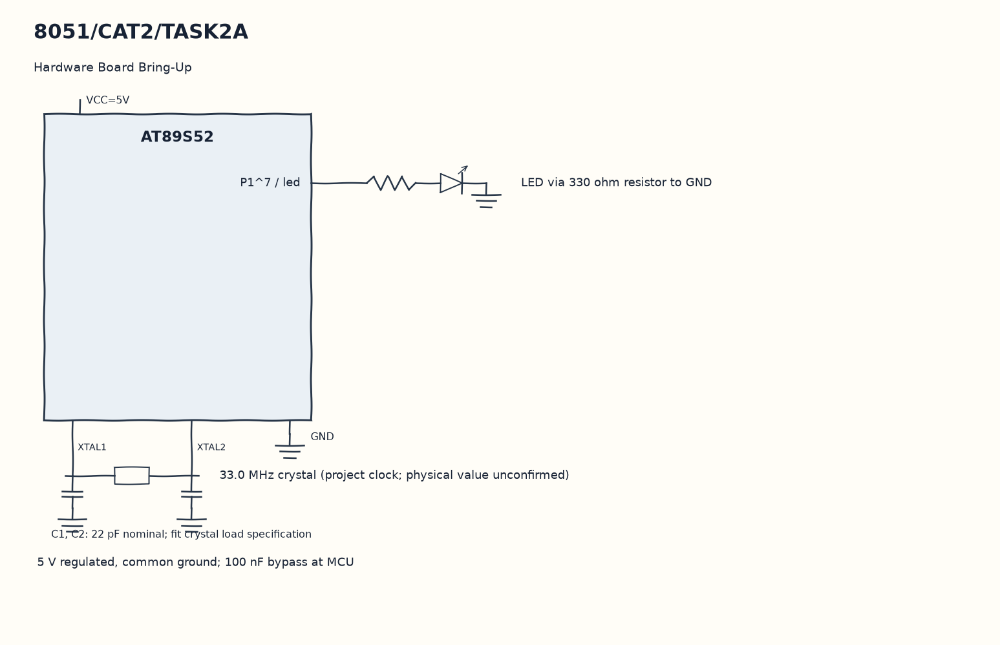

EXPERIMENT DETAILS
EXP: CONTINUOUS ASSESMENT 2
DATE: 20/07/2026
NAME OF EXP: 8051 Tool Chain setup – Development Board – AT89S52
HARDWARE SETUP / PLATFORM: 8051 Microcontroller + Keil µVision
TASK 2A : Hardware Board Bring-Up

1. Circuit Diagram
Set led high, wait, set it low and wait again to demonstrate 2A with the shown signals.

* Microcontroller / Board: 8051 development board + AT89S52.
* GPIO / Peripheral pins: P1^7 / led -> LED via 330 ohm resistor to GND.
* Clock: 33.0 MHz crystal (project clock; physical value unconfirmed).
* External components / Peripheral: LED via 330 ohm resistor to GND.
* Power Supply: 5 V regulated, common ground; 100 nF bypass at MCU.

2. Core Logic / Pseudocode / Code Base
Working Principle: The program starts with led low and repeats blink1 on P1^7. A high and a low output each have the same nested-loop wait, giving a simple board output check.

Pseudocode:

1. Clear the LED output.
2. Call blink1 inside the infinite loop.
3. Set led high, wait, set it low and wait again.

Code Base:
The program is written in Embedded C using Keil C51.

* `reg51.h` provides the 8051 register and bit names in this program.
* `delay()` runs the nested software wait loops here.
* `blink1()` writes both LED levels with equal software waits here.
* `sbit led = P1^7` gives direct access to the led signal.

3. Inference
Alternating output at P1^7 gives a basic indication that the program is running. This checks GPIO execution; voltage measurements and programmer identification still require a board check.
