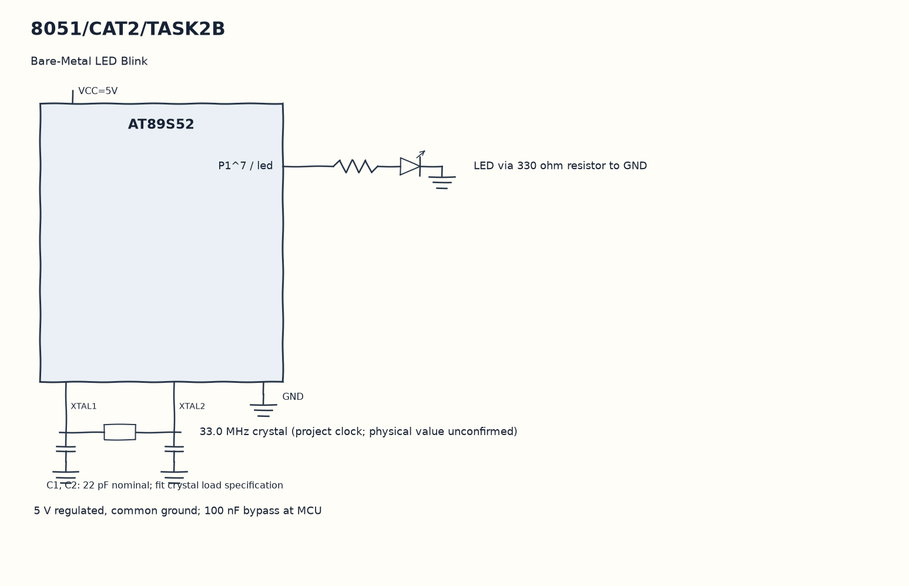

EXPERIMENT DETAILS
EXP: CONTINUOUS ASSESMENT 2
DATE: 20/07/2026
NAME OF EXP: 8051 Tool Chain setup – Development Board – AT89S52
HARDWARE SETUP / PLATFORM: 8051 Microcontroller + Keil µVision
TASK 2B : Bare-Metal LED Blink

1. Circuit Diagram
Repeat the high-delay-low-delay sequence to demonstrate 2B with the shown signals.

* Microcontroller / Board: 8051 development board + AT89S52.
* GPIO / Peripheral pins: P1^7 / led -> LED via 330 ohm resistor to GND.
* Clock: 33.0 MHz crystal (project clock; physical value unconfirmed).
* External components / Peripheral: LED via 330 ohm resistor to GND.
* Power Supply: 5 V regulated, common ground; 100 nF bypass at MCU.

2. Core Logic / Pseudocode / Code Base
Working Principle: blink1 writes one and zero to the LED bit in turn. delay keeps the processor busy with two loops of 400 iterations, so the blink interval depends on the clock and compiler.

Pseudocode:

1. Bind led to bit 7 of port 1.
2. Initialize led to zero.
3. Repeat the high-delay-low-delay sequence.

Code Base:
The program is written in Embedded C using Keil C51.

* `reg51.h` provides the 8051 register and bit names in this program.
* `delay()` runs the nested software wait loops here.
* `blink1()` writes both LED levels with equal software waits here.
* `sbit led = P1^7` gives direct access to the led signal.

3. Inference
The LED signal repeats continuously with similar high and low waits. Direct bit access and a software delay produce the blinking pattern; an exact 1 Hz rate has not been measured.
