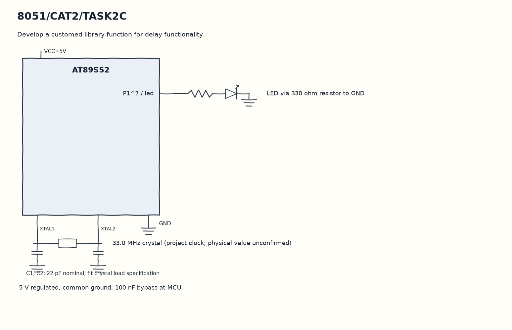

EXPERIMENT DETAILS
EXP: CONTINUOUS ASSESMENT 2
DATE: 20/07/2026
NAME OF EXP: 8051 Tool Chain setup – Development Board – AT89S52
HARDWARE SETUP / PLATFORM: 8051 Microcontroller + Keil µVision
TASK 2C : Develop a customed library function for delay functionality.

1. Circuit Diagram
Keep calling blink1 from main to demonstrate 2C with the shown signals.

* Microcontroller / Board: 8051 development board + AT89S52.
* GPIO / Peripheral pins: P1^7 / led -> LED via 330 ohm resistor to GND.
* Clock: 33.0 MHz crystal (project clock; physical value unconfirmed).
* External components / Peripheral: LED via 330 ohm resistor to GND.
* Power Supply: 5 V regulated, common ground; 100 nF bypass at MCU.

2. Core Logic / Pseudocode / Code Base
Working Principle: The repeated wait is kept in delay instead of duplicating the loop in blink1. Both LED transitions call the same function, showing how one delay routine can be reused.

Pseudocode:

1. Define the two nested delay loops once.
2. Call delay after raising P1^7.
3. Call delay again after lowering P1^7.
4. Keep calling blink1 from main.

Code Base:
The program is written in Embedded C using Keil C51.

* `reg51.h` provides the 8051 register and bit names in this program.
* `delay()` runs the nested software wait loops here.
* `blink1()` writes both LED levels with equal software waits here.
* `sbit led = P1^7` gives direct access to the led signal.

3. Inference
One delay function provides both waits in each blink cycle. This demonstrates function reuse in Embedded C without claiming a calibrated millisecond delay.
