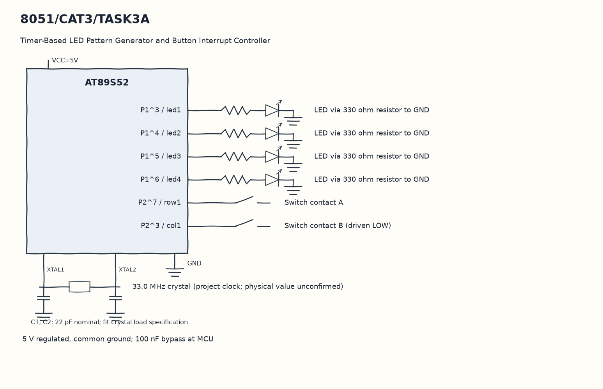

EXPERIMENT DETAILS
EXP: CONTINUOUS ASSESMENT 3
DATE: 27/07/2026
NAME OF EXP: Timer-Based LED Pattern Generator and Button Interrupt Controller
HARDWARE SETUP / PLATFORM: 8051 Microcontroller + Keil µVision
TASK 3A : Timer-Based LED Pattern Generator and Button Interrupt Controller

1. Circuit Diagram
Run the selected pattern using the LED functions and delay to demonstrate 3A with the shown signals.

* Microcontroller / Board: 8051 development board + AT89S52.
* GPIO / Peripheral pins: P1^3 / led1 -> LED via 330 ohm resistor to GND; P1^4 / led2 -> LED via 330 ohm resistor to GND; P1^5 / led3 -> LED via 330 ohm resistor to GND; P1^6 / led4 -> LED via 330 ohm resistor to GND; P2^7 / row1 -> Switch contact A; P2^3 / col1 -> Switch contact B (driven LOW).
* Clock: 33.0 MHz crystal (project clock; physical value unconfirmed).
* External components / Peripheral: LED via 330 ohm resistor to GND; Switch contact A; Switch contact B (driven LOW).
* Power Supply: 5 V regulated, common ground; 100 nF bypass at MCU.

2. Core Logic / Pseudocode / Code Base
Working Principle: button_pressed drives col1 low and reads row1. After the key is released, mode advances through running lights, a four-bit binary count, alternating lights and an all-light flash.

Pseudocode:

1. Start with all four LED bits cleared and mode zero.
2. Poll the row/column switch and wait for release.
3. Increase mode and wrap values above four back to one.
4. Run the selected pattern using the LED functions and delay.

Code Base:
The program is written in Embedded C using Keil C51.

* `reg51.h` provides the 8051 register and bit names in this program.
* `delay()` runs the nested software wait loops here.
* `mode_running()` drives the four LEDs in sequence here.
* `button_pressed()` drives the selected keypad column and reads the row contact here.
* `debounce()` waits for key release and then applies the software delay here.
* `mode_binary_count()` writes the four bits of each count to the LEDs here.
* `mode_alternating()` writes the two alternating LED patterns here.
* `mode_flash()` writes all LEDs high and then low here.
* `sbit led1 = P1^3` gives direct access to the led1 signal.
* `sbit led2 = P1^4` gives direct access to the led2 signal.
* `sbit led3 = P1^5` gives direct access to the led3 signal.
* `sbit led4 = P1^6` gives direct access to the led4 signal.
* `sbit row1 = P2^7` gives direct access to the row1 signal.
* `sbit col1 = P2^3` gives direct access to the col1 signal.

3. Inference
Each completed switch press selects the next pattern. The submitted source demonstrates a polled state controller; it does not configure a hardware timer or button interrupt despite the experiment title.
