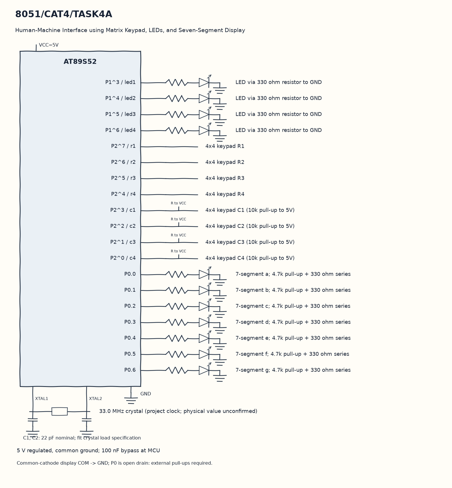

EXPERIMENT DETAILS
EXP: CONTINUOUS ASSESMENT 4
DATE: 03/08/2026
NAME OF EXP: Human-Machine Interface using Matrix Keypad, LEDs, and Seven-Segment Display
HARDWARE SETUP / PLATFORM: 8051 Microcontroller + Keil µVision
TASK 4A : Human-Machine Interface using Matrix Keypad, LEDs, and Seven-Segment Display

1. Circuit Diagram
Clear previous LEDs, then execute the action for keys 0 to 9 to demonstrate 4A with the shown signals.

* Microcontroller / Board: 8051 development board + AT89S52.
* GPIO / Peripheral pins: P1^3 / led1 -> LED via 330 ohm resistor to GND; P1^4 / led2 -> LED via 330 ohm resistor to GND; P1^5 / led3 -> LED via 330 ohm resistor to GND; P1^6 / led4 -> LED via 330 ohm resistor to GND; P2^7 / r1 -> 4x4 keypad R1; P2^6 / r2 -> 4x4 keypad R2; P2^5 / r3 -> 4x4 keypad R3; P2^4 / r4 -> 4x4 keypad R4; P2^3 / c1 -> 4x4 keypad C1 (10k pull-up to 5V); P2^2 / c2 -> 4x4 keypad C2 (10k pull-up to 5V); P2^1 / c3 -> 4x4 keypad C3 (10k pull-up to 5V); P2^0 / c4 -> 4x4 keypad C4 (10k pull-up to 5V); P0.0 -> 7-segment a; 4.7k pull-up + 330 ohm series; P0.1 -> 7-segment b; 4.7k pull-up + 330 ohm series; P0.2 -> 7-segment c; 4.7k pull-up + 330 ohm series; P0.3 -> 7-segment d; 4.7k pull-up + 330 ohm series; P0.4 -> 7-segment e; 4.7k pull-up + 330 ohm series; P0.5 -> 7-segment f; 4.7k pull-up + 330 ohm series; P0.6 -> 7-segment g; 4.7k pull-up + 330 ohm series.
* Clock: 33.0 MHz crystal (project clock; physical value unconfirmed).
* External components / Peripheral: LED via 330 ohm resistor to GND; 4x4 keypad R1; 4x4 keypad R2; 4x4 keypad R3; 4x4 keypad R4; 4x4 keypad C1 (10k pull-up to 5V); 4x4 keypad C2 (10k pull-up to 5V); 4x4 keypad C3 (10k pull-up to 5V); 4x4 keypad C4 (10k pull-up to 5V); 7-segment a; 4.7k pull-up + 330 ohm series; 7-segment b; 4.7k pull-up + 330 ohm series; 7-segment c; 4.7k pull-up + 330 ohm series; 7-segment d; 4.7k pull-up + 330 ohm series; 7-segment e; 4.7k pull-up + 330 ohm series; 7-segment f; 4.7k pull-up + 330 ohm series; 7-segment g; 4.7k pull-up + 330 ohm series.
* Power Supply: 5 V regulated, common ground; 100 nF bypass at MCU.

2. Core Logic / Pseudocode / Code Base
Working Principle: keypad_scan drives one keypad row low at a time and returns the key after release. display_digit writes a seven-segment pattern to P0, and led_control selects a light or runs the matching pattern.

Pseudocode:

1. Scan four rows and columns until a key is found.
2. Wait for that key to be released and return its character.
3. Write its segment pattern on P0.
4. Clear previous LEDs, then execute the action for keys 0 to 9.

Code Base:
The program is written in Embedded C using Keil C51.

* `reg51.h` provides the 8051 register and bit names in this program.
* `delay()` runs the nested software wait loops here.
* `display_digit()` selects the P0 seven-segment bit pattern here.
* `keypad_scan()` scans each row and returns the released key here.
* `mode_running()` drives the four LEDs in sequence here.
* `mode_binary_count()` writes the four bits of each count to the LEDs here.
* `mode_alternating()` writes the two alternating LED patterns here.
* `mode_flash()` writes all LEDs high and then low here.
* `led_control()` selects the LED action for the received key here.
* `sbit led1 = P1^3` gives direct access to the led1 signal.
* `sbit led2 = P1^4` gives direct access to the led2 signal.
* `sbit led3 = P1^5` gives direct access to the led3 signal.
* `sbit led4 = P1^6` gives direct access to the led4 signal.
* `sbit r1 = P2^7` gives direct access to the r1 signal.
* `sbit r2 = P2^6` gives direct access to the r2 signal.
* `sbit r3 = P2^5` gives direct access to the r3 signal.
* `sbit r4 = P2^4` gives direct access to the r4 signal.
* `sbit c1 = P2^3` gives direct access to the c1 signal.
* `sbit c2 = P2^2` gives direct access to the c2 signal.
* `sbit c3 = P2^1` gives direct access to the c3 signal.
* `sbit c4 = P2^0` gives direct access to the c4 signal.

3. Inference
A key has both a digit display result and an LED action. This joins matrix scanning, lookup patterns and function selection; keys A to F have segment patterns but no LED action.
