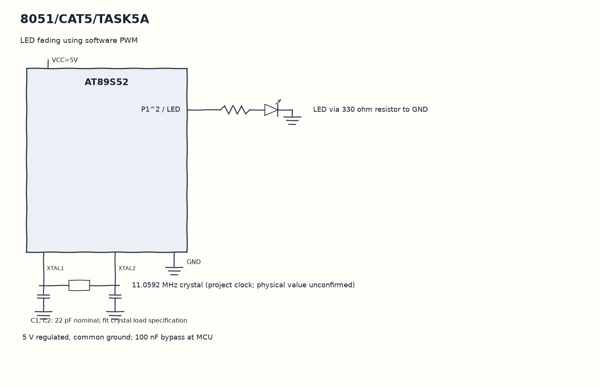

EXPERIMENT DETAILS
EXP: CONTINUOUS ASSESMENT 5
DATE: 10/08/2026
NAME OF EXP: Hardware Timer and Interrupt-Based Timing for LED Fading, Pulse Generation, and Stepper Motor Control
HARDWARE SETUP / PLATFORM: 8051 Microcontroller + Keil µVision
TASK 5A : LED fading using software PWM

1. Circuit Diagram
Change duty between zero and twenty and reverse at the endpoints to demonstrate 5A with the shown signals.

* Microcontroller / Board: 8051 development board + AT89S52.
* GPIO / Peripheral pins: P1^2 / LED -> LED via 330 ohm resistor to GND.
* Clock: 11.0592 MHz crystal (project clock; physical value unconfirmed).
* External components / Peripheral: LED via 330 ohm resistor to GND.
* Power Supply: 5 V regulated, common ground; 100 nF bypass at MCU.

2. Core Logic / Pseudocode / Code Base
Working Principle: Timer 0 overflow runs timer0 and reloads FF/A4. The ISR compares a 20-step phase with duty and moves duty up and down after 500 ticks, while main stays in an empty loop.

Pseudocode:

1. Configure Timer 0 in mode 1 and load the initial count.
2. Enable ET0, EA and TR0.
3. Advance the PWM phase on every interrupt.
4. Change duty between zero and twenty and reverse at the endpoints.

Code Base:
The program is written in Embedded C using Keil C51.

* `reg51.h` provides the 8051 register and bit names in this program.
* `timer0()` runs the Timer 0 interrupt work here.
* `sbit LED = P1^2` gives direct access to the LED signal.
* `TMOD` selects the timer modes in this copy.
* `TH0` sets the Timer 0 reload high byte in this copy.
* `TL0` sets the Timer 0 reload low byte in this copy.
* `TR0` starts Timer 0 in this copy.
* `ET0` enables the Timer 0 interrupt in this copy.
* `EA` enables global interrupt dispatch in this copy.

3. Inference
The output duty rises and falls repeatedly, producing a fading drive signal at P1^2. This demonstrates interrupt-timed software PWM; nominal timing assumes the 11.0592 MHz crystal and includes ISR overhead.
