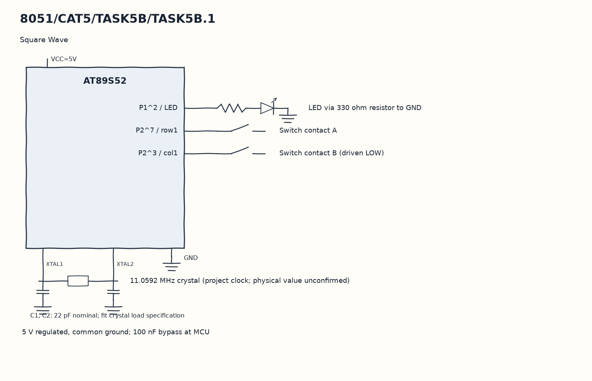

EXPERIMENT DETAILS
EXP: CONTINUOUS ASSESMENT 5
DATE: 10/08/2026
NAME OF EXP: Hardware Timer and Interrupt-Based Timing for LED Fading, Pulse Generation, and Stepper Motor Control
HARDWARE SETUP / PLATFORM: 8051 Microcontroller + Keil µVision
TASK 5B.1 : Square Wave

1. Circuit Diagram
On release, advance the reload mode from zero through four to demonstrate 5B.1 with the shown signals.

* Microcontroller / Board: 8051 development board + AT89S52.
* GPIO / Peripheral pins: P1^2 / LED -> LED via 330 ohm resistor to GND; P2^7 / row1 -> Switch contact A; P2^3 / col1 -> Switch contact B (driven LOW).
* Clock: 11.0592 MHz crystal (project clock; physical value unconfirmed).
* External components / Peripheral: LED via 330 ohm resistor to GND; Switch contact A; Switch contact B (driven LOW).
* Power Supply: 5 V regulated, common ground; 100 nF bypass at MCU.

2. Core Logic / Pseudocode / Code Base
Working Principle: The timer ISR loads a pair of bytes chosen by mode and complements LED. A release of the row1/col1 key selects the next reload pair without a software delay loop.

Pseudocode:

1. Start Timer 0 with the first half-period reload.
2. Toggle the output and reload on each overflow.
3. Remember a low key level.
4. On release, advance the reload mode from zero through four.

Code Base:
The program is written in Embedded C using Keil C51.

* `reg51.h` provides the 8051 register and bit names in this program.
* `timer0()` runs the Timer 0 interrupt work here.
* `sbit LED = P1^2` gives direct access to the LED signal.
* `sbit row1 = P2^7` gives direct access to the row1 signal.
* `sbit col1 = P2^3` gives direct access to the col1 signal.
* `TMOD` selects the timer modes in this copy.
* `TH0` sets the Timer 0 reload high byte in this copy.
* `TL0` sets the Timer 0 reload low byte in this copy.
* `TR0` starts Timer 0 in this copy.
* `ET0` enables the Timer 0 interrupt in this copy.
* `EA` enables global interrupt dispatch in this copy.

3. Inference
Five reload pairs give nominal 100 Hz, 500 Hz, 1 kHz, 2 kHz and 5 kHz square-wave settings. This demonstrates frequency control by timer reload; key debounce is not implemented and ISR time affects the measured frequency.
