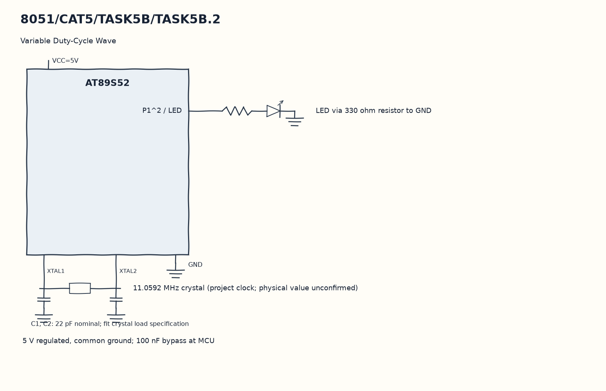

EXPERIMENT DETAILS
EXP: CONTINUOUS ASSESMENT 5
DATE: 10/08/2026
NAME OF EXP: Hardware Timer and Interrupt-Based Timing for LED Fading, Pulse Generation, and Stepper Motor Control
HARDWARE SETUP / PLATFORM: 8051 Microcontroller + Keil µVision
TASK 5B.2 : Variable Duty-Cycle Wave

1. Circuit Diagram
Cycle duty through the three programmed values to demonstrate 5B.2 with the shown signals.

* Microcontroller / Board: 8051 development board + AT89S52.
* GPIO / Peripheral pins: P1^2 / LED -> LED via 330 ohm resistor to GND.
* Clock: 11.0592 MHz crystal (project clock; physical value unconfirmed).
* External components / Peripheral: LED via 330 ohm resistor to GND.
* Power Supply: 5 V regulated, common ground; 100 nF bypass at MCU.

2. Core Logic / Pseudocode / Code Base
Working Principle: phase counts twenty timer interrupts for one output cycle. duty changes among five, ten and fifteen after 5000 interrupts, so the high portion changes while the phase length stays fixed.

Pseudocode:

1. Initialize the timer and enable interrupts.
2. Increment phase and wrap it at twenty.
3. Set the output only when phase is below duty.
4. Cycle duty through the three programmed values.

Code Base:
The program is written in Embedded C using Keil C51.

* `reg51.h` provides the 8051 register and bit names in this program.
* `timer0()` runs the Timer 0 interrupt work here.
* `sbit LED = P1^2` gives direct access to the LED signal.
* `TMOD` selects the timer modes in this copy.
* `TH0` sets the Timer 0 reload high byte in this copy.
* `TL0` sets the Timer 0 reload low byte in this copy.
* `TR0` starts Timer 0 in this copy.
* `ET0` enables the Timer 0 interrupt in this copy.
* `EA` enables global interrupt dispatch in this copy.

3. Inference
The P1^2 waveform changes among nominal 25, 50 and 75 percent duty. The example separates the duty comparison from the timer period, with actual frequency subject to interrupt overhead.
