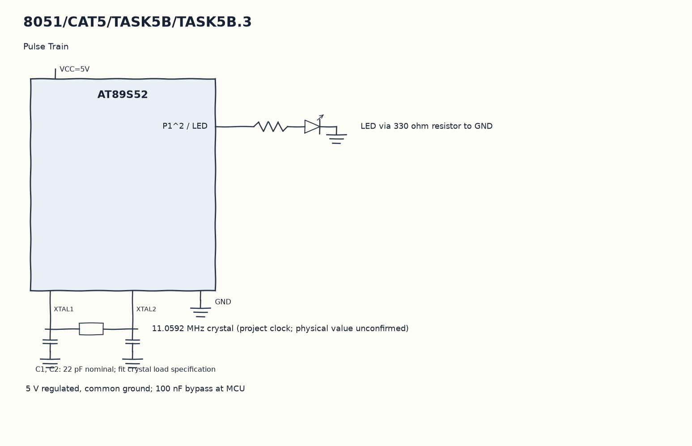

EXPERIMENT DETAILS
EXP: CONTINUOUS ASSESMENT 5
DATE: 10/08/2026
NAME OF EXP: Hardware Timer and Interrupt-Based Timing for LED Fading, Pulse Generation, and Stepper Motor Control
HARDWARE SETUP / PLATFORM: 8051 Microcontroller + Keil µVision
TASK 5B.3 : Pulse Train

1. Circuit Diagram
Write the phase-zero comparison to LED to demonstrate 5B.3 with the shown signals.

* Microcontroller / Board: 8051 development board + AT89S52.
* GPIO / Peripheral pins: P1^2 / LED -> LED via 330 ohm resistor to GND.
* Clock: 11.0592 MHz crystal (project clock; physical value unconfirmed).
* External components / Peripheral: LED via 330 ohm resistor to GND.
* Power Supply: 5 V regulated, common ground; 100 nF bypass at MCU.

2. Core Logic / Pseudocode / Code Base
Working Principle: The ISR counts from zero to nine and drives LED high only when the count is zero. FC/66 is reloaded after each overflow, so there is one high interval in each ten-interval group.

Pseudocode:

1. Load the nominal one-millisecond reload.
2. Enable Timer 0 interrupts.
3. Increase ms_count and wrap it at ten.
4. Write the phase-zero comparison to LED.

Code Base:
The program is written in Embedded C using Keil C51.

* `reg51.h` provides the 8051 register and bit names in this program.
* `timer0()` runs the Timer 0 interrupt work here.
* `sbit LED = P1^2` gives direct access to the LED signal.
* `TMOD` selects the timer modes in this copy.
* `TH0` sets the Timer 0 reload high byte in this copy.
* `TL0` sets the Timer 0 reload low byte in this copy.
* `TR0` starts Timer 0 in this copy.
* `ET0` enables the Timer 0 interrupt in this copy.
* `EA` enables global interrupt dispatch in this copy.

3. Inference
P1^2 carries a repeating narrow pulse train with nominal ten percent duty. Counting interrupt intervals produces the pulse spacing without a blocking delay in main.
