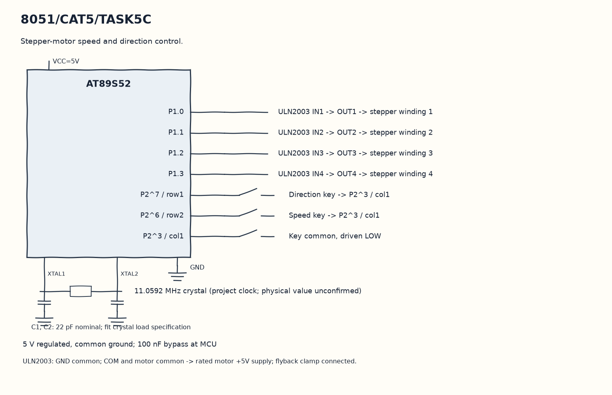

EXPERIMENT DETAILS
EXP: CONTINUOUS ASSESMENT 5
DATE: 10/08/2026
NAME OF EXP: Hardware Timer and Interrupt-Based Timing for LED Fading, Pulse Generation, and Stepper Motor Control
HARDWARE SETUP / PLATFORM: 8051 Microcontroller + Keil µVision
TASK 5C : Stepper-motor speed and direction control.

1. Circuit Diagram
Write the next coil pattern after 100, 50 or 10 ticks to demonstrate 5C with the shown signals.

* Microcontroller / Board: 8051 development board + AT89S52.
* GPIO / Peripheral pins: P1.0 -> ULN2003 IN1 -> OUT1 -> stepper winding 1; P1.1 -> ULN2003 IN2 -> OUT2 -> stepper winding 2; P1.2 -> ULN2003 IN3 -> OUT3 -> stepper winding 3; P1.3 -> ULN2003 IN4 -> OUT4 -> stepper winding 4; P2^7 / row1 -> Direction key -> P2^3 / col1; P2^6 / row2 -> Speed key -> P2^3 / col1; P2^3 / col1 -> Key common, driven LOW.
* Clock: 11.0592 MHz crystal (project clock; physical value unconfirmed).
* External components / Peripheral: ULN2003 IN1 -> OUT1 -> stepper winding 1; ULN2003 IN2 -> OUT2 -> stepper winding 2; ULN2003 IN3 -> OUT3 -> stepper winding 3; ULN2003 IN4 -> OUT4 -> stepper winding 4; Direction key -> P2^3 / col1; Speed key -> P2^3 / col1; Key common, driven LOW.
* Power Supply: 5 V regulated, common ground; 100 nF bypass at MCU.

2. Core Logic / Pseudocode / Code Base
Working Principle: A four-entry sequence drives the low nibble of P1 through the motor driver. The ISR waits for the selected tick count before stepping and uses two release-qualified keys to change direction and speed.

Pseudocode:

1. Set the keypad column low and enable the timer.
2. Qualify each key release for twenty ticks.
3. Use one key to reverse direction and the other to select a step interval.
4. Write the next coil pattern after 100, 50 or 10 ticks.

Code Base:
The program is written in Embedded C using Keil C51.

* `reg51.h` provides the 8051 register and bit names in this program.
* `timer0()` runs the Timer 0 interrupt work here.
* `sbit row1 = P2^7` gives direct access to the row1 signal.
* `sbit row2 = P2^6` gives direct access to the row2 signal.
* `sbit col1 = P2^3` gives direct access to the col1 signal.
* `TMOD` selects the timer modes in this copy.
* `TH0` sets the Timer 0 reload high byte in this copy.
* `TL0` sets the Timer 0 reload low byte in this copy.
* `TR0` starts Timer 0 in this copy.
* `ET0` enables the Timer 0 interrupt in this copy.
* `EA` enables global interrupt dispatch in this copy.

3. Inference
The coil order can reverse and the interval can change while the timer keeps running. This shows timed step sequencing; a motor driver and its rated supply are needed before connecting the motor.
