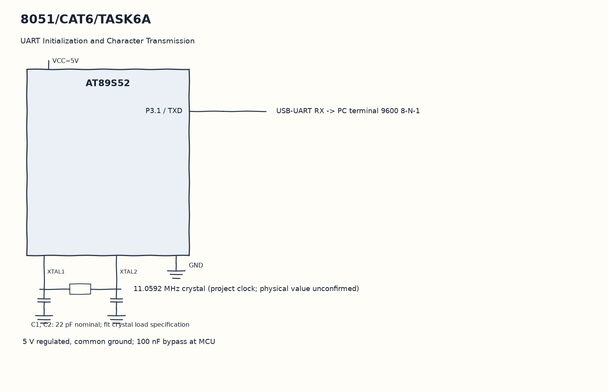

EXPERIMENT DETAILS
EXP: CONTINUOUS ASSESMENT 6
DATE: 17/08/2026
NAME OF EXP: UART Driver and Serial Debugging
HARDWARE SETUP / PLATFORM: 8051 Microcontroller + Keil µVision
TASK 6A : UART Initialization and Character Transmission

1. Circuit Diagram
Send each byte through uart_send and repeat the string to demonstrate 6A with the shown signals.

* Microcontroller / Board: 8051 development board + AT89S52.
* GPIO / Peripheral pins: P3.1 / TXD -> USB-UART RX -> PC terminal 9600 8-N-1.
* Clock: 11.0592 MHz crystal (project clock; physical value unconfirmed).
* External components / Peripheral: USB-UART RX -> PC terminal 9600 8-N-1.
* Power Supply: 5 V regulated, common ground; 100 nF bypass at MCU.

2. Core Logic / Pseudocode / Code Base
Working Principle: uart_init selects Timer 1 auto-reload and UART mode 1. main walks through Hello from 8051 followed by CR/LF, sending one byte at a time and waiting for TI.

Pseudocode:

1. Set TMOD, TH1, PCON and SCON for the assumed serial clock.
2. Start Timer 1 and clear UART flags.
3. Point msg at the greeting.
4. Send each byte through uart_send and repeat the string.

Code Base:
The program is written in Embedded C using Keil C51.

* `reg51.h` provides the 8051 register and bit names in this program.
* `uart_init()` sets the UART and Timer 1 registers here.
* `uart_send()` writes SBUF and waits for TI here.
* `TMOD` selects the timer modes in this copy.
* `TH1` sets the Timer 1 baud reload in this copy.
* `TR1` starts Timer 1 in this copy.
* `PCON` sets the UART baud multiplier bit in this copy.
* `SCON` selects serial mode and receive enable in this copy.
* `SBUF` carries the transmitted or received byte in this copy.
* `RI` indicates a received character in this copy.
* `TI` indicates transmit completion in this copy.

3. Inference
A terminal set to 9600 8-N-1 should receive repeated greeting lines with the assumed crystal. The code demonstrates polled character transmission rather than an interrupt-driven ring buffer.
