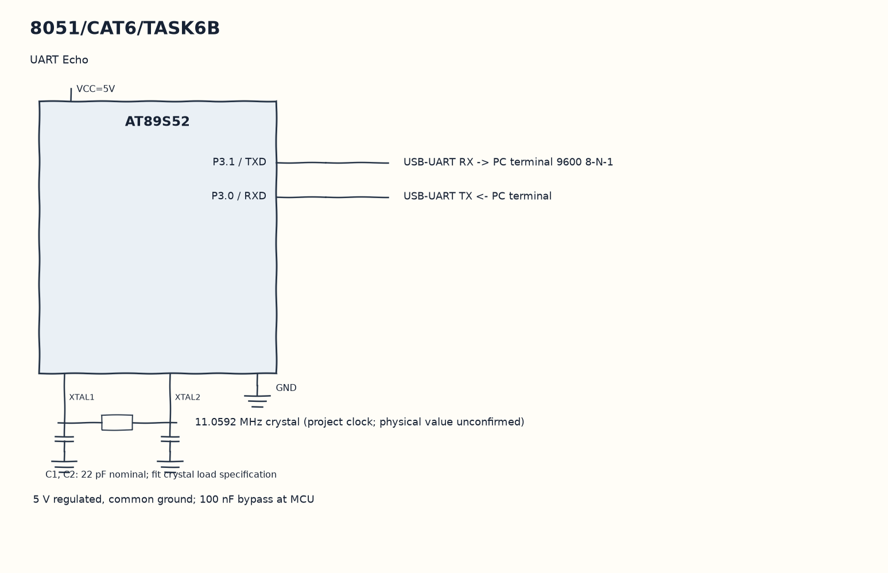

EXPERIMENT DETAILS
EXP: CONTINUOUS ASSESMENT 6
DATE: 17/08/2026
NAME OF EXP: UART Driver and Serial Debugging
HARDWARE SETUP / PLATFORM: 8051 Microcontroller + Keil µVision
TASK 6B : UART Echo

1. Circuit Diagram
Transmit it back and wait for completion to demonstrate 6B with the shown signals.

* Microcontroller / Board: 8051 development board + AT89S52.
* GPIO / Peripheral pins: P3.1 / TXD -> USB-UART RX -> PC terminal 9600 8-N-1; P3.0 / RXD -> USB-UART TX <- PC terminal.
* Clock: 11.0592 MHz crystal (project clock; physical value unconfirmed).
* External components / Peripheral: USB-UART RX -> PC terminal 9600 8-N-1; USB-UART TX <- PC terminal.
* Power Supply: 5 V regulated, common ground; 100 nF bypass at MCU.

2. Core Logic / Pseudocode / Code Base
Working Principle: main waits for RI, reads SBUF and clears RI. It puts that same byte back in SBUF, waits for TI and clears the transmit flag before accepting the next byte.

Pseudocode:

1. Initialize the UART and baud-rate timer.
2. Wait until a receive flag is set.
3. Read and acknowledge the received byte.
4. Transmit it back and wait for completion.

Code Base:
The program is written in Embedded C using Keil C51.

* `reg51.h` provides the 8051 register and bit names in this program.
* `uart_init()` sets the UART and Timer 1 registers here.
* `TMOD` selects the timer modes in this copy.
* `TH1` sets the Timer 1 baud reload in this copy.
* `TR1` starts Timer 1 in this copy.
* `PCON` sets the UART baud multiplier bit in this copy.
* `SCON` selects serial mode and receive enable in this copy.
* `SBUF` carries the transmitted or received byte in this copy.
* `RI` indicates a received character in this copy.
* `TI` indicates transmit completion in this copy.

3. Inference
Each received character is returned unchanged to the terminal. This demonstrates a polling echo path; there is no software receive ring buffer and no UART ISR in this copy.
