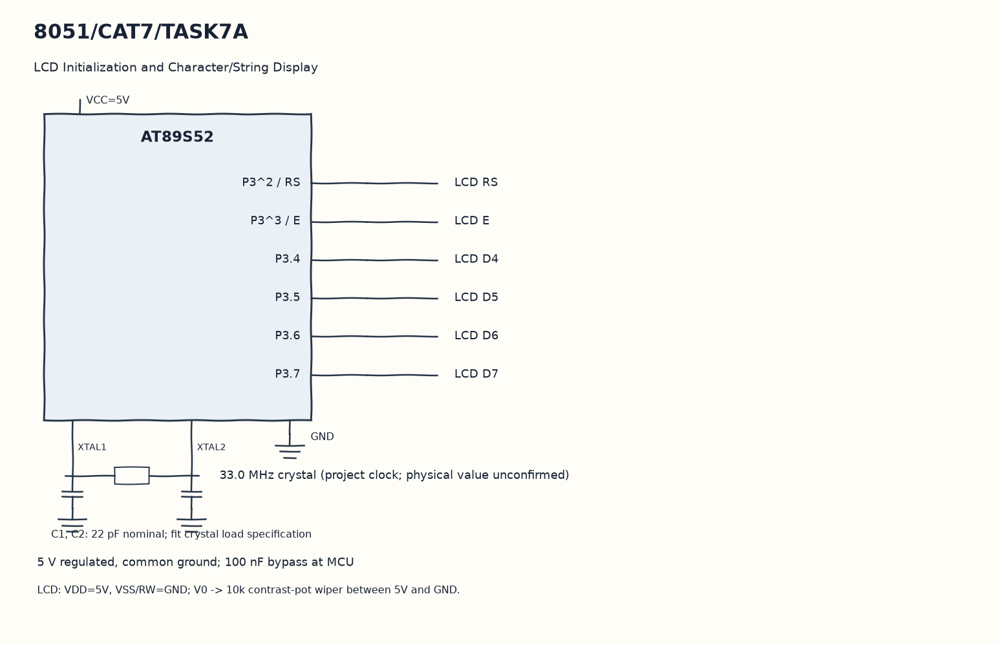

EXPERIMENT DETAILS
EXP: CONTINUOUS ASSESMENT 7
DATE: 24/08/2026
NAME OF EXP: 16×2 LCD Driver Development and Dynamic Display Control
HARDWARE SETUP / PLATFORM: 8051 Microcontroller + Keil µVision
TASK 7A : LCD Initialization and Character/String Display

1. Circuit Diagram
Select row two and send the second string to demonstrate 7A with the shown signals.

* Microcontroller / Board: 8051 development board + AT89S52.
* GPIO / Peripheral pins: P3^2 / RS -> LCD RS; P3^3 / E -> LCD E; P3.4 -> LCD D4; P3.5 -> LCD D5; P3.6 -> LCD D6; P3.7 -> LCD D7.
* Clock: 33.0 MHz crystal (project clock; physical value unconfirmed).
* External components / Peripheral: LCD RS; LCD E; LCD D4; LCD D5; LCD D6; LCD D7; LCD RW grounded and 10k contrast potentiometer.
* Power Supply: 5 V regulated, common ground; 100 nF bypass at MCU.

2. Core Logic / Pseudocode / Code Base
Working Principle: lcd_init sends the power-on nibbles and the four-bit display commands. The program writes S and the registration string on the first row, then writes LCD display on the second row.

Pseudocode:

1. Drive RS and E low and send the initialization sequence.
2. Select the first row and send S.
3. Write the registration string with lcd_puts.
4. Select row two and send the second string.

Code Base:
The program is written in Embedded C using Keil C51.

* `reg51.h` provides the 8051 register and bit names in this program.
* `delay()` runs the nested software wait loops here.
* `enable()` pulses E to latch the current LCD nibble here.
* `lcd_cmd()` sends a command as two nibbles with RS low here.
* `lcd_data()` sends one character as two nibbles with RS high here.
* `lcd_init()` sends the LCD power-on and display configuration sequence here.
* `lcd_goto()` selects a row and column DDRAM address here.
* `lcd_puts()` sends successive string characters here.
* `sbit RS = P3^2` gives direct access to the RS signal.
* `sbit E = P3^3` gives direct access to the E signal.

3. Inference
The two LCD rows receive different text through the same four-bit data bus. Command selection and data writes are separated by the RS bit.
