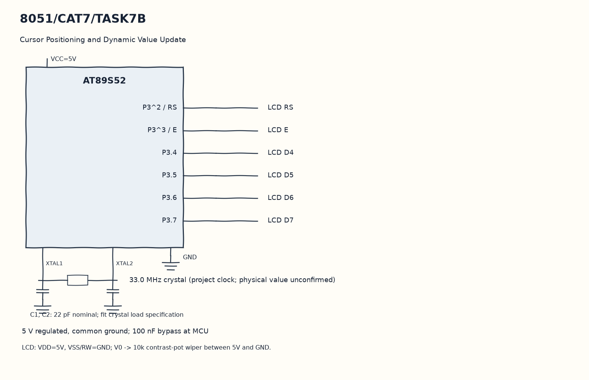

EXPERIMENT DETAILS
EXP: CONTINUOUS ASSESMENT 7
DATE: 24/08/2026
NAME OF EXP: 16×2 LCD Driver Development and Dynamic Display Control
HARDWARE SETUP / PLATFORM: 8051 Microcontroller + Keil µVision
TASK 7B : Cursor Positioning and Dynamic Value Update

1. Circuit Diagram
Convert the next value into digits and send them in order to demonstrate 7B with the shown signals.

* Microcontroller / Board: 8051 development board + AT89S52.
* GPIO / Peripheral pins: P3^2 / RS -> LCD RS; P3^3 / E -> LCD E; P3.4 -> LCD D4; P3.5 -> LCD D5; P3.6 -> LCD D6; P3.7 -> LCD D7.
* Clock: 33.0 MHz crystal (project clock; physical value unconfirmed).
* External components / Peripheral: LCD RS; LCD E; LCD D4; LCD D5; LCD D6; LCD D7; LCD RW grounded and 10k contrast potentiometer.
* Power Supply: 5 V regulated, common ground; 100 nF bypass at MCU.

2. Core Logic / Pseudocode / Code Base
Working Principle: lcd_goto selects a DDRAM address for a row and column. The loop clears a five-character field, prints the increasing value there and waits with repeated calls to delay.

Pseudocode:

1. Initialize and clear the LCD.
2. Print Count on row zero.
3. Erase the old numeric field on row one.
4. Convert the next value into digits and send them in order.

Code Base:
The program is written in Embedded C using Keil C51.

* `reg51.h` provides the 8051 register and bit names in this program.
* `delay()` runs the nested software wait loops here.
* `enable()` pulses E to latch the current LCD nibble here.
* `lcd_cmd()` sends a command as two nibbles with RS low here.
* `lcd_data()` sends one character as two nibbles with RS high here.
* `lcd_init()` sends the LCD power-on and display configuration sequence here.
* `lcd_goto()` selects a row and column DDRAM address here.
* `lcd_puts()` sends successive string characters here.
* `lcd_print_number()` extracts decimal digits and sends them in display order here.
* `sbit RS = P3^2` gives direct access to the RS signal.
* `sbit E = P3^3` gives direct access to the E signal.

3. Inference
The numeric field changes without clearing the whole display. This demonstrates cursor positioning and decimal conversion; the unsigned counter eventually wraps.
