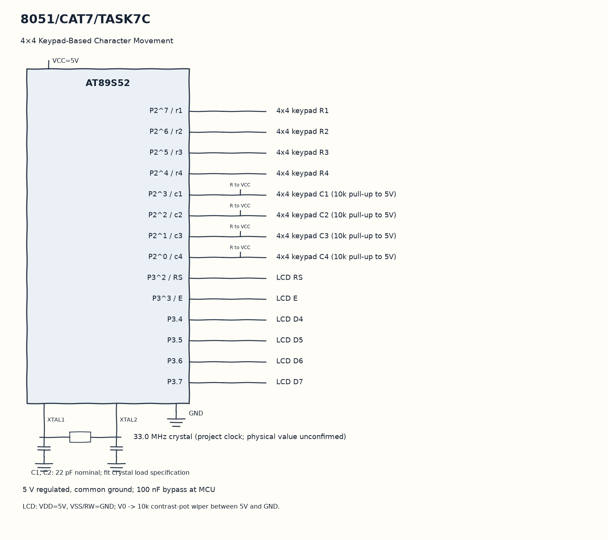

EXPERIMENT DETAILS
EXP: CONTINUOUS ASSESMENT 7
DATE: 24/08/2026
NAME OF EXP: 16×2 LCD Driver Development and Dynamic Display Control
HARDWARE SETUP / PLATFORM: 8051 Microcontroller + Keil µVision
TASK 7C : 4×4 Keypad-Based Character Movement

1. Circuit Diagram
Change the row or column for a direction key, then draw S at the new position to demonstrate 7C with the shown signals.

* Microcontroller / Board: 8051 development board + AT89S52.
* GPIO / Peripheral pins: P2^7 / r1 -> 4x4 keypad R1; P2^6 / r2 -> 4x4 keypad R2; P2^5 / r3 -> 4x4 keypad R3; P2^4 / r4 -> 4x4 keypad R4; P2^3 / c1 -> 4x4 keypad C1 (10k pull-up to 5V); P2^2 / c2 -> 4x4 keypad C2 (10k pull-up to 5V); P2^1 / c3 -> 4x4 keypad C3 (10k pull-up to 5V); P2^0 / c4 -> 4x4 keypad C4 (10k pull-up to 5V); P3^2 / RS -> LCD RS; P3^3 / E -> LCD E; P3.4 -> LCD D4; P3.5 -> LCD D5; P3.6 -> LCD D6; P3.7 -> LCD D7.
* Clock: 33.0 MHz crystal (project clock; physical value unconfirmed).
* External components / Peripheral: 4x4 keypad R1; 4x4 keypad R2; 4x4 keypad R3; 4x4 keypad R4; 4x4 keypad C1 (10k pull-up to 5V); 4x4 keypad C2 (10k pull-up to 5V); 4x4 keypad C3 (10k pull-up to 5V); 4x4 keypad C4 (10k pull-up to 5V); LCD RS; LCD E; LCD D4; LCD D5; LCD D6; LCD D7; LCD RW grounded and 10k contrast potentiometer.
* Power Supply: 5 V regulated, common ground; 100 nF bypass at MCU.

2. Core Logic / Pseudocode / Code Base
Working Principle: The keypad scanner returns a released key and the LCD shows S at the saved row and column. Keys 2, 8, 4 and 6 update that position within the two-row, sixteen-column limits.

Pseudocode:

1. Show S at row zero and column zero.
2. Read a key with the matrix scanner.
3. Erase the previous character.
4. Change the row or column for a direction key, then draw S at the new position.

Code Base:
The program is written in Embedded C using Keil C51.

* `reg51.h` provides the 8051 register and bit names in this program.
* `delay()` runs the nested software wait loops here.
* `enable()` pulses E to latch the current LCD nibble here.
* `lcd_cmd()` sends a command as two nibbles with RS low here.
* `lcd_data()` sends one character as two nibbles with RS high here.
* `lcd_init()` sends the LCD power-on and display configuration sequence here.
* `lcd_goto()` selects a row and column DDRAM address here.
* `keypad_scan()` scans each row and returns the released key here.
* `sbit r1 = P2^7` gives direct access to the r1 signal.
* `sbit r2 = P2^6` gives direct access to the r2 signal.
* `sbit r3 = P2^5` gives direct access to the r3 signal.
* `sbit r4 = P2^4` gives direct access to the r4 signal.
* `sbit c1 = P2^3` gives direct access to the c1 signal.
* `sbit c2 = P2^2` gives direct access to the c2 signal.
* `sbit c3 = P2^1` gives direct access to the c3 signal.
* `sbit c4 = P2^0` gives direct access to the c4 signal.
* `sbit RS = P3^2` gives direct access to the RS signal.
* `sbit E = P3^3` gives direct access to the E signal.

3. Inference
The character moves inside the display boundaries instead of wrapping around them. Keypad input controls LCD DDRAM positioning in this interactive example.
