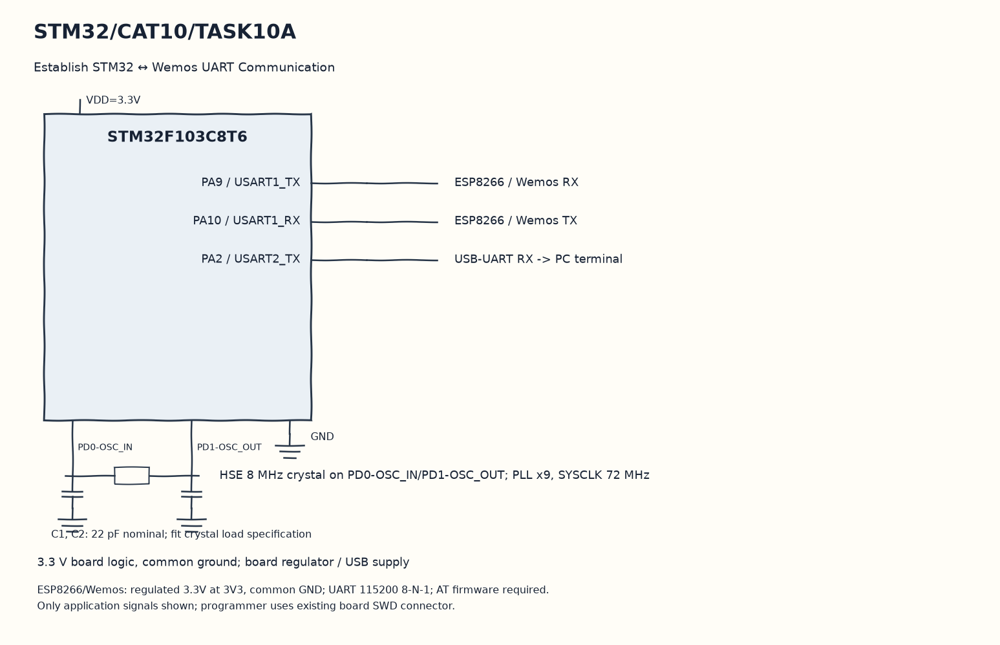

EXPERIMENT DETAILS
EXP: CONTINUOUS ASSESMENT 10
DATE: 05/10/2026
NAME OF EXP: STM32–Wemos Wi-Fi Modem Interface Using AT Commands
HARDWARE SETUP / PLATFORM: Blue Pill development board + STM32F103C8T6 + ESP8266 + STM32CubeMX (MDK-ARM project)
TASK 10A : Establish STM32 ↔ Wemos UART Communication

1. Circuit Diagram
Finish the two-second wait and stay in the main loop to demonstrate 10A with the shown signals.

* Microcontroller / Board: Blue Pill development board + STM32F103C8T6.
* GPIO / Peripheral pins: PA9 / USART1_TX -> ESP8266 / Wemos RX; PA10 / USART1_RX -> ESP8266 / Wemos TX; PA2 / USART2_TX -> USB-UART RX -> PC terminal.
* Clock: HSE 8 MHz crystal on PD0-OSC_IN/PD1-OSC_OUT; PLL x9, SYSCLK 72 MHz.
* External components / Peripheral: ESP8266 / Wemos RX; ESP8266 / Wemos TX; USB-UART RX -> PC terminal.
* Power Supply: 3.3 V board logic, common ground; board regulator / USB supply.

2. Core Logic / Pseudocode / Code Base
Working Principle: The original active sequence sends AT with CR/LF over USART1. Incoming modem bytes are forwarded to USART2 until the receive call times out, then main waits in its empty loop.

Pseudocode:

1. Prepare the receive array and AT string.
2. Transmit the string on huart1.
3. Receive one modem byte at a time and forward it on huart2.
4. Finish the two-second wait and stay in the main loop.

Code Base:
The program is written in Embedded C using STM32 HAL (STM32CubeMX).

* `main.h` provides the project HAL declarations in this program.
* `string.h` provides string length, comparison and buffer functions in this program.
* `HAL_UART_Transmit()` sends bytes on the selected UART handle here.
* `strlen()` counts actual string bytes for serial or HTTP length here.
* `HAL_UART_Receive()` receives bytes with the requested timeout here.
* `HAL_Delay()` waits for the programmed millisecond interval here.

3. Inference
An AT-firmware modem can return its response to the PC serial terminal. This task isolates the UART communication check without joining a network or starting a server.
