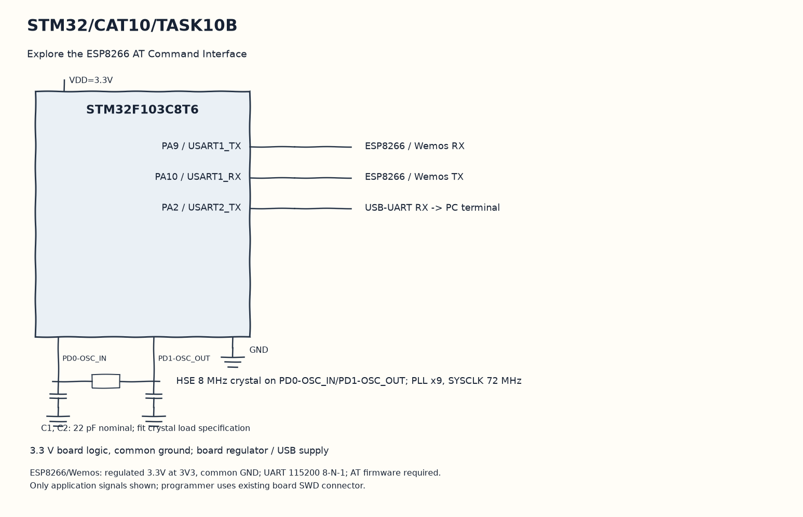

EXPERIMENT DETAILS
EXP: CONTINUOUS ASSESMENT 10
DATE: 05/10/2026
NAME OF EXP: STM32–Wemos Wi-Fi Modem Interface Using AT Commands
HARDWARE SETUP / PLATFORM: Blue Pill development board + STM32F103C8T6 + ESP8266 + STM32CubeMX (MDK-ARM project)
TASK 10B : Explore the ESP8266 AT Command Interface

1. Circuit Diagram
For each command, copy the received bytes to the terminal until timeout to demonstrate 10B with the shown signals.

* Microcontroller / Board: Blue Pill development board + STM32F103C8T6.
* GPIO / Peripheral pins: PA9 / USART1_TX -> ESP8266 / Wemos RX; PA10 / USART1_RX -> ESP8266 / Wemos TX; PA2 / USART2_TX -> USB-UART RX -> PC terminal.
* Clock: HSE 8 MHz crystal on PD0-OSC_IN/PD1-OSC_OUT; PLL x9, SYSCLK 72 MHz.
* External components / Peripheral: ESP8266 / Wemos RX; ESP8266 / Wemos TX; USB-UART RX -> PC terminal.
* Power Supply: 3.3 V board logic, common ground; board regulator / USB supply.

2. Core Logic / Pseudocode / Code Base
Working Principle: send_command transmits each investigation command and forwards modem responses to the PC UART. The startup sequence asks about firmware, station mode, visible networks, current association and IP information.

Pseudocode:

1. Initialize the two UARTs.
2. Send AT, AT+GMR and AT+CWMODE=1.
3. Send AT+CWLAP, AT+CWJAP? and AT+CIFSR.
4. For each command, copy the received bytes to the terminal until timeout.

Code Base:
The program is written in Embedded C using STM32 HAL (STM32CubeMX).

* `main.h` provides the project HAL declarations in this program.
* `string.h` provides string length, comparison and buffer functions in this program.
* `string.h` provides string length, comparison and buffer functions in this program.
* `send_command()` sends an AT command and forwards its reply to the PC UART here.
* `HAL_UART_Transmit()` sends bytes on the selected UART handle here.
* `strlen()` counts actual string bytes for serial or HTTP length here.
* `HAL_UART_Receive()` receives bytes with the requested timeout here.

3. Inference
The terminal receives the modem information that its firmware supports. The sequence demonstrates AT command investigation; it does not assert that the modem is connected to an access point.
