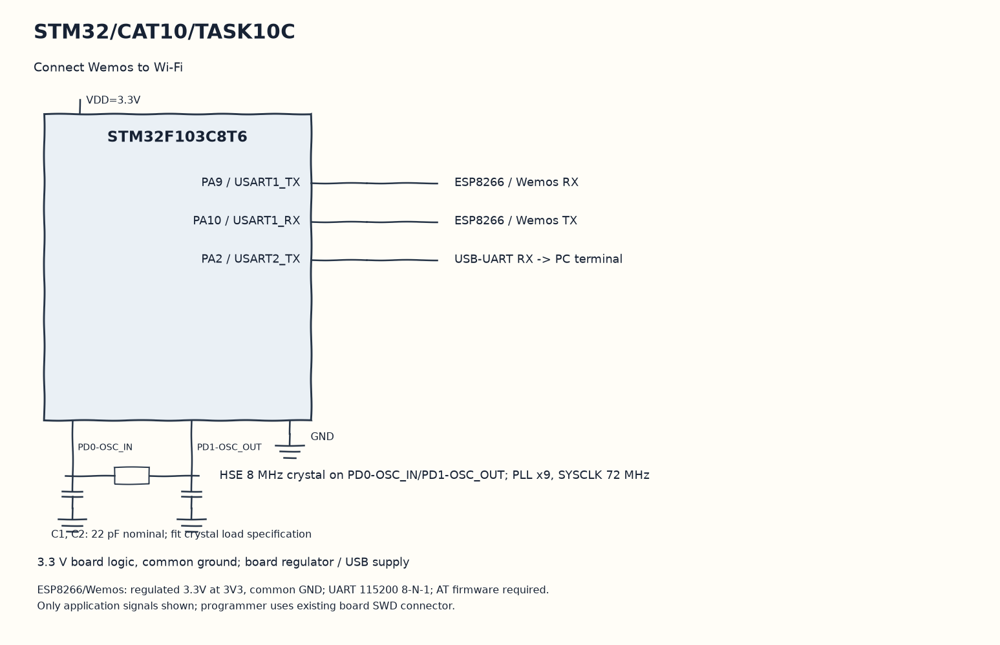

EXPERIMENT DETAILS
EXP: CONTINUOUS ASSESMENT 10
DATE: 05/10/2026
NAME OF EXP: STM32–Wemos Wi-Fi Modem Interface Using AT Commands
HARDWARE SETUP / PLATFORM: Blue Pill development board + STM32F103C8T6 + ESP8266 + STM32CubeMX (MDK-ARM project)
TASK 10C : Connect Wemos to Wi-Fi

1. Circuit Diagram
Ask for CIFSR and forward all received replies to demonstrate 10C with the shown signals.

* Microcontroller / Board: Blue Pill development board + STM32F103C8T6.
* GPIO / Peripheral pins: PA9 / USART1_TX -> ESP8266 / Wemos RX; PA10 / USART1_RX -> ESP8266 / Wemos TX; PA2 / USART2_TX -> USB-UART RX -> PC terminal.
* Clock: HSE 8 MHz crystal on PD0-OSC_IN/PD1-OSC_OUT; PLL x9, SYSCLK 72 MHz.
* External components / Peripheral: ESP8266 / Wemos RX; ESP8266 / Wemos TX; USB-UART RX -> PC terminal.
* Power Supply: 3.3 V board logic, common ground; board regulator / USB supply.

2. Core Logic / Pseudocode / Code Base
Working Principle: This copy sends the saved station-mode and join commands from the original commented sequence. It forwards each reply to the terminal and ends by asking the modem for its IP information.

Pseudocode:

1. Test modem response with AT.
2. Set CWMODE to station mode.
3. Issue the saved CWJAP command.
4. Ask for CIFSR and forward all received replies.

Code Base:
The program is written in Embedded C using STM32 HAL (STM32CubeMX).

* `main.h` provides the project HAL declarations in this program.
* `string.h` provides string length, comparison and buffer functions in this program.
* `HAL_UART_Transmit()` sends bytes on the selected UART handle here.
* `strlen()` counts actual string bytes for serial or HTTP length here.
* `HAL_UART_Receive()` receives bytes with the requested timeout here.
* `HAL_Delay()` waits for the programmed millisecond interval here.
* `memset()` clears the selected byte buffer here.

3. Inference
The modem is asked to join the network stored in the original source. Its terminal response is the evidence of success or failure; this code does not independently verify the connection status.
