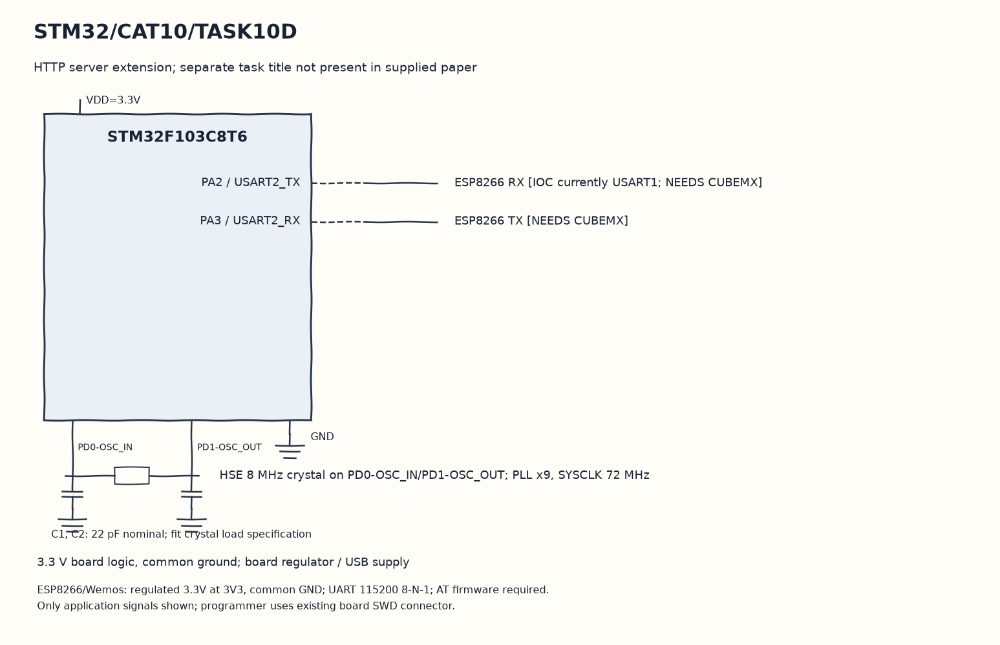

EXPERIMENT DETAILS
EXP: CONTINUOUS ASSESMENT 10
DATE: 05/10/2026
NAME OF EXP: STM32–Wemos Wi-Fi Modem Interface Using AT Commands
HARDWARE SETUP / PLATFORM: Blue Pill development board + STM32F103C8T6 + ESP8266 + STM32CubeMX (MDK-ARM project)
TASK 10D : HTTP server extension; separate task title not present in supplied paper

1. Circuit Diagram
Request CIPSEND, transmit the response and close link zero to demonstrate 10D with the shown signals.

* Microcontroller / Board: Blue Pill development board + STM32F103C8T6.
* GPIO / Peripheral pins: PA2 / USART2_TX -> ESP8266 RX [IOC currently USART1; NEEDS CUBEMX]; PA3 / USART2_RX -> ESP8266 TX [NEEDS CUBEMX].
* Clock: HSE 8 MHz crystal on PD0-OSC_IN/PD1-OSC_OUT; PLL x9, SYSCLK 72 MHz.
* External components / Peripheral: ESP8266 RX [IOC currently USART1; NEEDS CUBEMX]; ESP8266 TX [NEEDS CUBEMX].
* Power Supply: 3.3 V board logic, common ground; board regulator / USB supply.

2. Core Logic / Pseudocode / Code Base
Working Principle: The website code configures station mode, joins the saved network and starts a multi-connection server on port 80. It recognizes an IPD request for link zero and sends an HTML response with an increasing counter.

Pseudocode:

1. Transmit the six saved setup commands and read their responses.
2. Collect incoming UART bytes in rx_data.
3. When link zero contains GET /, build the counter page and its HTTP headers.
4. Request CIPSEND, transmit the response and close link zero.

Code Base:
The program is written in Embedded C using STM32 HAL (STM32CubeMX).

* `main.h` provides the project HAL declarations in this program.
* `string.h` provides string length, comparison and buffer functions in this program.
* `stdio.h` provides the formatted text functions in this program.
* `clear_buffer()` clears the receive text and its index here.
* `memset()` clears the selected byte buffer here.
* `receive_response()` collects modem replies until the saved stop condition or timeout here.
* `HAL_UART_Receive()` receives bytes with the requested timeout here.
* `strstr()` finds the request or modem response marker here.
* `send_http_response()` constructs and sends this task HTTP reply here.
* `sprintf()` formats the saved response or command text here.
* `strlen()` counts actual string bytes for serial or HTTP length here.
* `HAL_UART_Transmit()` sends bytes on the selected UART handle here.
* `HAL_Delay()` waits for the programmed millisecond interval here.

3. Inference
Repeated requests to link zero receive increasing New num values when the modem is configured correctly. This is an HTTP extension found in the own source, but the copied IOC/UART mismatch must be resolved first.

NEEDS CUBEMX: IOC specifies USART1 PA9/PA10 but generated application uses USART2 PA2/PA3. In CubeMX disable USART1; enable USART2 asynchronous 115200 baud, 8 data bits, no parity, 1 stop bit, TX/RX, PA2 TX/PA3 RX; retain HSE 8MHz PLL x9 SYSCLK72MHz APB1 36MHz. Regenerate MDK-ARM with Keep User Code.
