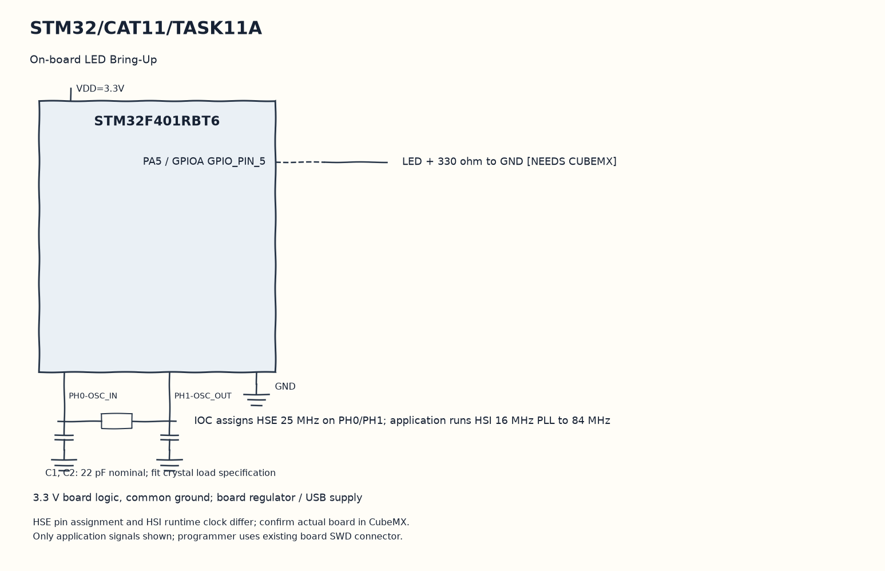

EXPERIMENT DETAILS
EXP: CONTINUOUS ASSESMENT 11
DATE: 14/10/2026
NAME OF EXP: STM32F401RE Cortex-M4: GPIO and User Input Programming
HARDWARE SETUP / PLATFORM: STM32F401RB development board (physical board unconfirmed) + STM32F401RBT6 + GPIO LED and input + STM32CubeMX (MDK-ARM project)
TASK 11A : On-board LED Bring-Up

1. Circuit Diagram
Repeat the toggle after the missing output configuration is generated to demonstrate 11A with the shown signals.

* Microcontroller / Board: STM32F401RB development board (physical board unconfirmed) + STM32F401RBT6.
* GPIO / Peripheral pins: PA5 / GPIOA GPIO_PIN_5 -> LED + 330 ohm to GND [NEEDS CUBEMX].
* Clock: IOC assigns HSE 25 MHz on PH0/PH1; application runs HSI 16 MHz PLL to 84 MHz.
* External components / Peripheral: LED + 330 ohm to GND [NEEDS CUBEMX].
* Power Supply: 3.3 V board logic, common ground; board regulator / USB supply.

2. Core Logic / Pseudocode / Code Base
Working Principle: The prepared USER CODE toggles PA5 and waits five hundred milliseconds. The original F401 scaffold does not configure that LED pin, so the loop is ready for the listed CubeMX GPIO regeneration.

Pseudocode:

1. Initialize HAL and the original clock.
2. Run the generated GPIO initialization.
3. Toggle PA5 and wait half a second.
4. Repeat the toggle after the missing output configuration is generated.

Code Base:
The program is written in Embedded C using STM32 HAL (STM32CubeMX).

* `main.h` provides the project HAL declarations in this program.
* `HAL_GPIO_TogglePin()` changes the stored LED output state here.
* `HAL_Delay()` waits for the programmed millisecond interval here.

3. Inference
PA5 is intended to blink after CubeMX configures it as an output. The current project is preparation for the hardware bring-up and cannot demonstrate the LED before that change.

NEEDS CUBEMX: Confirm physical board MCU: own scaffold is STM32F401RBT6, paper names NUCLEO-F401RE. Select actual MCU/board in CubeMX (NUCLEO-F401RE if that is fitted), PA5 GPIO_Output push-pull/no pull/low speed initial LOW, PC13 GPIO_Input pull-up for B1 active LOW (B/C only), SYS Serial Wire, HSI16MHz PLL M=8 N=84 P=2 ->84MHz, APB1 /2 APB2 /1. Disable unused USART1 and unused external HSE pins if using HSI. MDK-ARM; Keep User Code.
