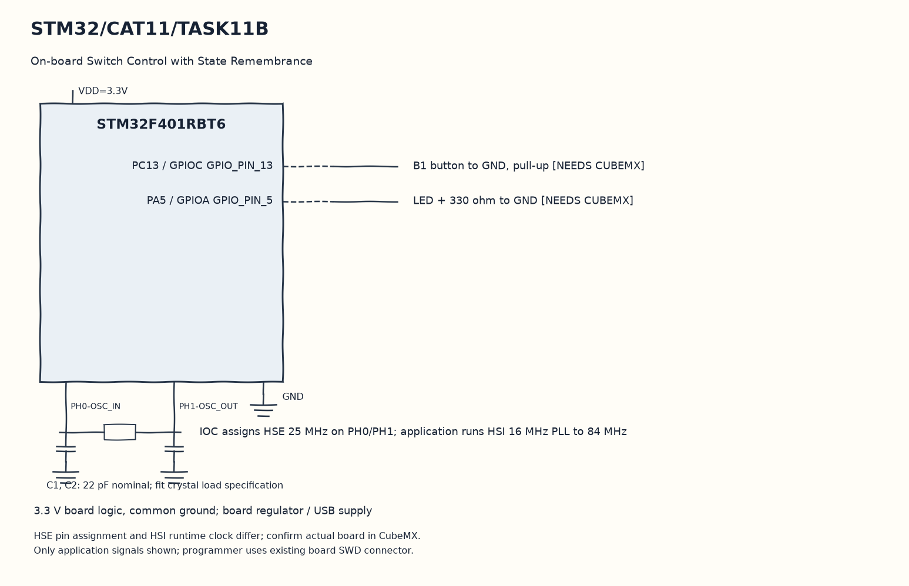

EXPERIMENT DETAILS
EXP: CONTINUOUS ASSESMENT 11
DATE: 14/10/2026
NAME OF EXP: STM32F401RE Cortex-M4: GPIO and User Input Programming
HARDWARE SETUP / PLATFORM: STM32F401RB development board (physical board unconfirmed) + STM32F401RBT6 + GPIO LED and input + STM32CubeMX (MDK-ARM project)
TASK 11B : On-board Switch Control with State Remembrance

1. Circuit Diagram
On release, toggle PA5 and preserve that output until the next event to demonstrate 11B with the shown signals.

* Microcontroller / Board: STM32F401RB development board (physical board unconfirmed) + STM32F401RBT6.
* GPIO / Peripheral pins: PC13 / GPIOC GPIO_PIN_13 -> B1 button to GND, pull-up [NEEDS CUBEMX]; PA5 / GPIOA GPIO_PIN_5 -> LED + 330 ohm to GND [NEEDS CUBEMX].
* Clock: IOC assigns HSE 25 MHz on PH0/PH1; application runs HSI 16 MHz PLL to 84 MHz.
* External components / Peripheral: B1 button to GND, pull-up [NEEDS CUBEMX]; LED + 330 ohm to GND [NEEDS CUBEMX].
* Power Supply: 3.3 V board logic, common ground; board regulator / USB supply.

2. Core Logic / Pseudocode / Code Base
Working Principle: PC13 transitions are filtered with a twenty-millisecond tick comparison. A stable release toggles PA5 once and the output latch remembers the state, but both application GPIO settings still need regeneration.

Pseudocode:

1. Read the intended PC13 button input.
2. Track raw changes and accept a stable level after twenty milliseconds.
3. Record the press timestamp.
4. On release, toggle PA5 and preserve that output until the next event.

Code Base:
The program is written in Embedded C using STM32 HAL (STM32CubeMX).

* `main.h` provides the project HAL declarations in this program.
* `HAL_GetTick()` returns the millisecond time used for event comparisons here.
* `HAL_GPIO_ReadPin()` reads the application switch level here.
* `HAL_GPIO_TogglePin()` changes the stored LED output state here.

3. Inference
The prepared loop gives one remembered LED change per completed press. The source demonstrates event state handling while its physical input and output configuration remains pending.

NEEDS CUBEMX: Confirm physical board MCU: own scaffold is STM32F401RBT6, paper names NUCLEO-F401RE. Select actual MCU/board in CubeMX (NUCLEO-F401RE if that is fitted), PA5 GPIO_Output push-pull/no pull/low speed initial LOW, PC13 GPIO_Input pull-up for B1 active LOW (B/C only), SYS Serial Wire, HSI16MHz PLL M=8 N=84 P=2 ->84MHz, APB1 /2 APB2 /1. Disable unused USART1 and unused external HSE pins if using HSI. MDK-ARM; Keep User Code.
