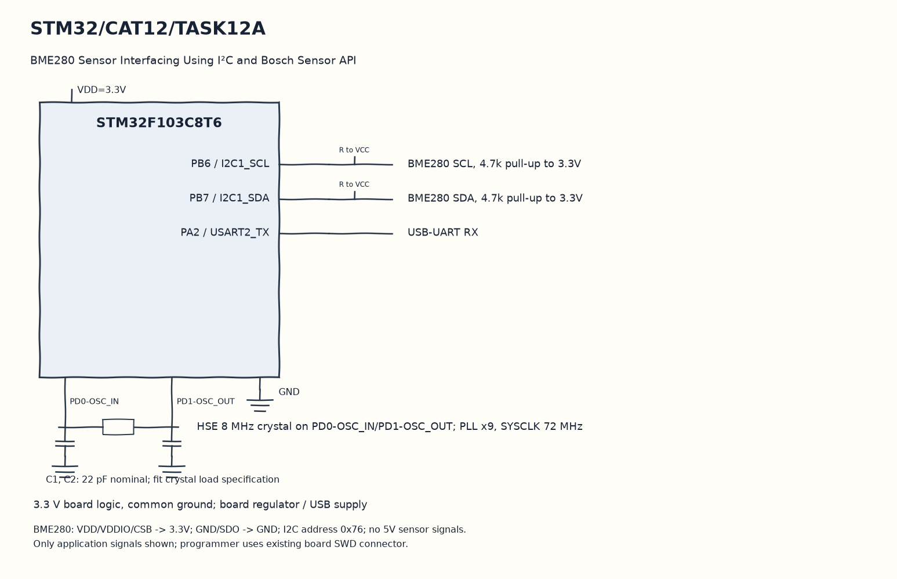

EXPERIMENT DETAILS
EXP: CONTINUOUS ASSESMENT 12
DATE: 23/10/2026
NAME OF EXP: Sensor Interfacing(BME280) – STM32(Debug) – ESP8266(Wi-Fi) HTTP – Node Analytics
HARDWARE SETUP / PLATFORM: Blue Pill development board + STM32F103C8T6 + BME280 + STM32CubeMX (MDK-ARM project)
TASK 12A : BME280 Sensor Interfacing Using I²C and Bosch Sensor API

1. Circuit Diagram
Convert pressure to hPa, format a terminal line and wait one second to demonstrate 12A with the shown signals.

* Microcontroller / Board: Blue Pill development board + STM32F103C8T6.
* GPIO / Peripheral pins: PB6 / I2C1_SCL -> BME280 SCL, 4.7k pull-up to 3.3V; PB7 / I2C1_SDA -> BME280 SDA, 4.7k pull-up to 3.3V; PA2 / USART2_TX -> USB-UART RX.
* Clock: HSE 8 MHz crystal on PD0-OSC_IN/PD1-OSC_OUT; PLL x9, SYSCLK 72 MHz.
* External components / Peripheral: BME280 SCL, 4.7k pull-up to 3.3V; BME280 SDA, 4.7k pull-up to 3.3V; USB-UART RX.
* Power Supply: 3.3 V board logic, common ground; board regulator / USB supply.

2. Core Logic / Pseudocode / Code Base
Working Principle: The Bosch device uses the own I2C read, write and delay wrappers at address 0x76. After one-times oversampling is configured, the loop reads compensated values and prints successful readings on USART2.

Pseudocode:

1. Initialize I2C1, USART2 and the Bosch function pointers.
2. Load calibration through bme280_init and set sensor settings.
3. Read temperature, pressure and humidity.
4. Convert pressure to hPa, format a terminal line and wait one second.

Code Base:
The program is written in Embedded C using STM32 HAL (STM32CubeMX).

* `main.h` provides the project HAL declarations in this program.
* `string.h` provides string length, comparison and buffer functions in this program.
* `bme280.h` declares the Bosch sensor API in this program.
* `stdio.h` provides the formatted text functions in this program.
* `user_i2c_read()` adapts the Bosch read callback to HAL here.
* `HAL_I2C_Mem_Read()` reads sensor registers through hi2c1 here.
* `user_i2c_write()` adapts the Bosch write callback to HAL here.
* `HAL_I2C_Mem_Write()` writes sensor registers through hi2c1 here.
* `user_delay_us()` rounds the Bosch microsecond delay request up to a HAL millisecond wait here.
* `HAL_Delay()` waits for the programmed millisecond interval here.
* `bme280_init()` reads sensor calibration through the supplied callbacks here.
* `bme280_set_sensor_settings()` applies the saved oversampling and filter settings here.
* `bme280_set_sensor_mode()` selects normal sensor operation here.
* `bme280_get_sensor_data()` obtains compensated sensor channel values here.
* `snprintf()` formats text within a stated buffer size here.
* `HAL_UART_Transmit()` sends bytes on the selected UART handle here.
* `strlen()` counts actual string bytes for serial or HTTP length here.

3. Inference
Successful sensor reads produce temperature, pressure and humidity text on the terminal. This copy keeps the I2C-to-UART path and removes the unrelated HTTP application.
