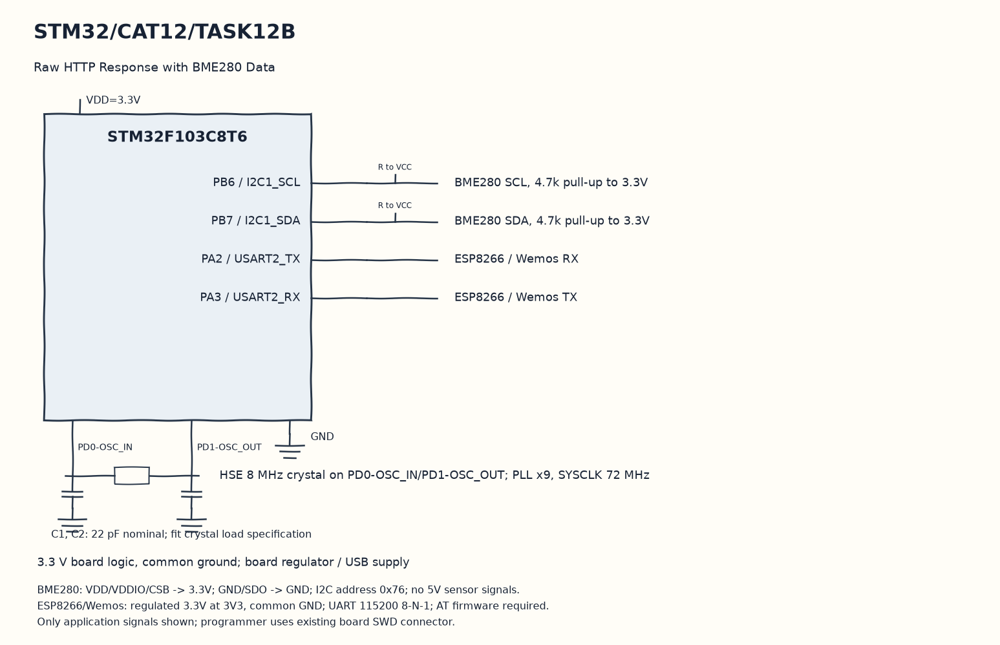

EXPERIMENT DETAILS
EXP: CONTINUOUS ASSESMENT 12
DATE: 23/10/2026
NAME OF EXP: Sensor Interfacing(BME280) – STM32(Debug) – ESP8266(Wi-Fi) HTTP – Node Analytics
HARDWARE SETUP / PLATFORM: Blue Pill development board + STM32F103C8T6 + BME280 + ESP8266 + STM32CubeMX (MDK-ARM project)
TASK 12B : Raw HTTP Response with BME280 Data

1. Circuit Diagram
Read the sensor, build success or error JSON, send it and close the connection to demonstrate 12B with the shown signals.

* Microcontroller / Board: Blue Pill development board + STM32F103C8T6.
* GPIO / Peripheral pins: PB6 / I2C1_SCL -> BME280 SCL, 4.7k pull-up to 3.3V; PB7 / I2C1_SDA -> BME280 SDA, 4.7k pull-up to 3.3V; PA2 / USART2_TX -> ESP8266 / Wemos RX; PA3 / USART2_RX -> ESP8266 / Wemos TX.
* Clock: HSE 8 MHz crystal on PD0-OSC_IN/PD1-OSC_OUT; PLL x9, SYSCLK 72 MHz.
* External components / Peripheral: BME280 SCL, 4.7k pull-up to 3.3V; BME280 SDA, 4.7k pull-up to 3.3V; ESP8266 / Wemos RX; ESP8266 / Wemos TX.
* Power Supply: 3.3 V board logic, common ground; board regulator / USB supply.

2. Core Logic / Pseudocode / Code Base
Working Principle: The original BME280 wrappers and HTTP response helper are used together in this copy. A complete link-zero request triggers a fresh read and a JSON response whose Content-Length comes from the actual JSON string.

Pseudocode:

1. Initialize the sensor and the previously omitted USART2 initialization call.
2. Send the saved ESP station and port-80 server commands.
3. Wait for a complete link-zero HTTP header.
4. Read the sensor, build success or error JSON, send it and close the connection.

Code Base:
The program is written in Embedded C using STM32 HAL (STM32CubeMX).

* `main.h` provides the project HAL declarations in this program.
* `string.h` provides string length, comparison and buffer functions in this program.
* `bme280.h` declares the Bosch sensor API in this program.
* `stdio.h` provides the formatted text functions in this program.
* `user_i2c_read()` adapts the Bosch read callback to HAL here.
* `HAL_I2C_Mem_Read()` reads sensor registers through hi2c1 here.
* `user_i2c_write()` adapts the Bosch write callback to HAL here.
* `HAL_I2C_Mem_Write()` writes sensor registers through hi2c1 here.
* `user_delay_us()` rounds the Bosch microsecond delay request up to a HAL millisecond wait here.
* `HAL_Delay()` waits for the programmed millisecond interval here.
* `clear_buffer()` clears the receive text and its index here.
* `memset()` clears the selected byte buffer here.
* `receive_response()` collects modem replies until the saved stop condition or timeout here.
* `HAL_UART_Receive()` receives bytes with the requested timeout here.
* `strstr()` finds the request or modem response marker here.
* `send_http_response()` constructs and sends this task HTTP reply here.
* `bme280_get_sensor_data()` obtains compensated sensor channel values here.
* `snprintf()` formats text within a stated buffer size here.
* `strlen()` counts actual string bytes for serial or HTTP length here.
* `HAL_UART_Transmit()` sends bytes on the selected UART handle here.
* `bme280_init()` reads sensor calibration through the supplied callbacks here.
* `bme280_set_sensor_settings()` applies the saved oversampling and filter settings here.
* `bme280_set_sensor_mode()` selects normal sensor operation here.

3. Inference
A successful request returns live environmental readings, while a failed read returns an error message instead of stale success data. This joins compensated I2C sensing with an HTTP response over the ESP UART.
