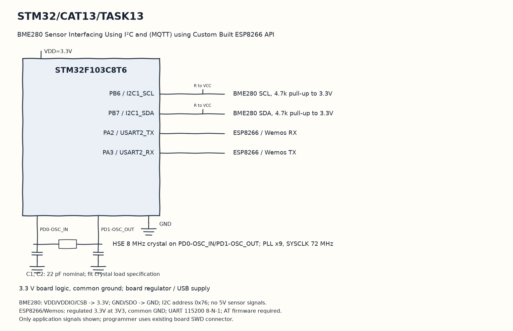

EXPERIMENT DETAILS
EXP: CONTINUOUS ASSESMENT 13
DATE: 27/10/2026
NAME OF EXP: Sensor Interfacing(BME280) – (MQTT) – Node Analytics
HARDWARE SETUP / PLATFORM: Blue Pill development board + STM32F103C8T6 + BME280 + ESP8266 + STM32CubeMX (MDK-ARM project)
TASK 13 : BME280 Sensor Interfacing Using I²C and (MQTT) using Custom Built ESP8266 API

1. Circuit Diagram
Use flows.json to subscribe and calculate live sensor statistics to demonstrate 13 with the shown signals.

* Microcontroller / Board: Blue Pill development board + STM32F103C8T6.
* GPIO / Peripheral pins: PB6 / I2C1_SCL -> BME280 SCL, 4.7k pull-up to 3.3V; PB7 / I2C1_SDA -> BME280 SDA, 4.7k pull-up to 3.3V; PA2 / USART2_TX -> ESP8266 / Wemos RX; PA3 / USART2_RX -> ESP8266 / Wemos TX.
* Clock: HSE 8 MHz crystal on PD0-OSC_IN/PD1-OSC_OUT; PLL x9, SYSCLK 72 MHz.
* External components / Peripheral: BME280 SCL, 4.7k pull-up to 3.3V; BME280 SDA, 4.7k pull-up to 3.3V; ESP8266 / Wemos RX; ESP8266 / Wemos TX.
* Power Supply: 3.3 V board logic, common ground; board regulator / USB supply.

2. Core Logic / Pseudocode / Code Base
Working Principle: The own Bosch sensor code is combined with the own ESP library using the F103 sensor project UART. After Wi-Fi and MQTT connection setup, the application formats successful readings as JSON and publishes to stm32/data once per loop.

Pseudocode:

1. Initialize I2C1, USART2 and the BME280 settings.
2. Initialize the ESP station, join the saved network and open the stored broker connection.
3. Complete MQTT_connectBroker with the task client ID.
4. Read compensated measurements, publish the JSON and wait one second.
5. Use flows.json to subscribe and calculate live sensor statistics.

Code Base:
The program is written in Embedded C using STM32 HAL (STM32CubeMX).

* `main.h` provides the project HAL declarations in this program.
* `string.h` provides string length, comparison and buffer functions in this program.
* `bme280.h` declares the Bosch sensor API in this program.
* `ESPLib.h` declares the own ESP and MQTT library interface in this program.
* `stdio.h` provides the formatted text functions in this program.
* `user_i2c_read()` adapts the Bosch read callback to HAL here.
* `HAL_I2C_Mem_Read()` reads sensor registers through hi2c1 here.
* `user_i2c_write()` adapts the Bosch write callback to HAL here.
* `HAL_I2C_Mem_Write()` writes sensor registers through hi2c1 here.
* `user_delay_us()` rounds the Bosch microsecond delay request up to a HAL millisecond wait here.
* `HAL_Delay()` waits for the programmed millisecond interval here.
* `bme280_init()` reads sensor calibration through the supplied callbacks here.
* `bme280_set_sensor_settings()` applies the saved oversampling and filter settings here.
* `bme280_set_sensor_mode()` selects normal sensor operation here.
* `ESP8266_Init()` tests and configures the ESP station interface here.
* `ESP8266_wifiConnect()` sends the saved access-point connection settings here.
* `ESP8266_portConnect()` opens the stored TCP broker connection here.
* `MQTT_connectBroker()` sends the MQTT client connection packet here.
* `bme280_get_sensor_data()` obtains compensated sensor channel values here.
* `snprintf()` formats text within a stated buffer size here.
* `MQTT_publishTopic()` sends the topic and application payload through the ESP library here.
* `flows.json` subscribes to `stm32/data` and calculates the running statistics from received JSON.

3. Inference
The subscriber can receive environmental JSON from successful sensor reads. The integration demonstrates sensor-to-MQTT transfer; the saved Wi-Fi settings, broker availability and actual hardware still require verification.
