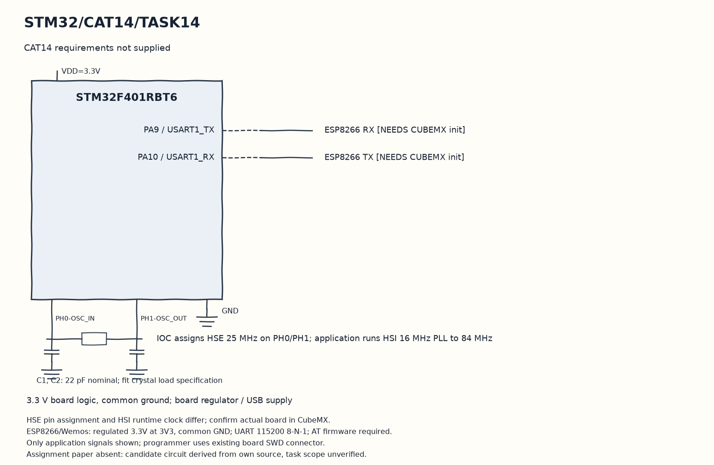

# TASK14 – MQTT Client Publishing & Node-RED Integration

## Experiment Details

| Field | Details |
|---|---|
| Experiment | Continuous Assessment 14 |
| Title | MQTT Client Publishing & Node-RED Integration |
| MCU target | STM32F401RBT6 |
| Wi-Fi module | ESP8266 |
| Development tools | STM32CubeMX, Keil MDK-ARM |
| Programming language | Embedded C (STM32 HAL) |

## Aim

To establish MQTT communication through an ESP8266 Wi-Fi module, publish a message periodically from the STM32, and configure Node-RED to subscribe to the published topic.

## Hardware Setup and Circuit Diagram

| STM32 connection | ESP8266 connection |
|---|---|
| PA9 (USART1_TX) | RX |
| PA10 (USART1_RX) | TX |
| GND | GND |
| Regulated 3.3 V supply suitable for the module | Power |



USART1 is configured for 115200 baud, 8 data bits, no parity and one stop bit. The MCU system clock is configured to 84 MHz.

## MQTT Configuration

| Parameter | Value |
|---|---|
| Broker | broker.emqx.io |
| Port | 1883 (TCP) |
| Client ID | STM32_Publisher |
| Topic | stm32/data |
| Payload | Good Morning |
| Quality of service | QoS 0 |
| Keep-alive | 500 seconds |
| Session | Clean session |
| Publishing delay | 1000 ms |

## Working Principle

The STM32 initializes USART1 and communicates with the ESP8266 using the ESP library. The Wi-Fi module connects to the configured access point and opens a TCP connection to the MQTT broker. The firmware configures an MQTT client, connects to the broker and repeatedly publishes the greeting message with a one-second delay between publishing calls.

## Pseudocode

1. Initialize HAL, the system clock, GPIO and USART1.
2. Initialize the ESP8266 in station mode.
3. Connect to a Wi-Fi access point using locally configured credentials.
4. Establish a TCP connection to the MQTT broker.
5. Configure the MQTT client and connect to the broker.
6. Publish the message "Good Morning" to `stm32/data` using QoS 0.
7. Wait 1000 ms and repeat step 6.

## Core Code

```c
while (1)
{
    MQTT_publishTopic("stm32/data", "Good Morning", QoS0);
    HAL_Delay(1000);
}
```

## Node-RED Integration

To receive the published messages:

1. Add an MQTT In node and configure the broker as `broker.emqx.io` on port `1883`.
2. Set the subscription topic to `stm32/data` and QoS to 0.
3. Connect the MQTT In node to a Debug node.
4. Deploy the flow and run the STM32 firmware with valid Wi-Fi settings.
5. Observe the incoming payload in the Debug sidebar.

`STM32 → ESP8266 → MQTT Broker → Node-RED`

The expected payload is `Good Morning`. The subscription procedure is provided for testing; a saved Node-RED flow and live test results are not included in this task.

## Project Files

- [Core/Src/main.c](Core/Src/main.c) – MQTT publishing application.
- [lab 13.ioc](lab%2013.ioc) – STM32CubeMX configuration.
- [Keil project](MDK-ARM/lab%2013.uvprojx) – MDK-ARM project file.
- [circuit.png](circuit.png) – Hardware circuit diagram.

## Inference

MQTT enables an embedded device to publish data to a broker without communicating directly with the receiving application. A Node-RED subscriber can receive messages on the same topic, demonstrating the publish-subscribe architecture used in IoT systems. Compilation and hardware operation of the current project remain to be verified.
