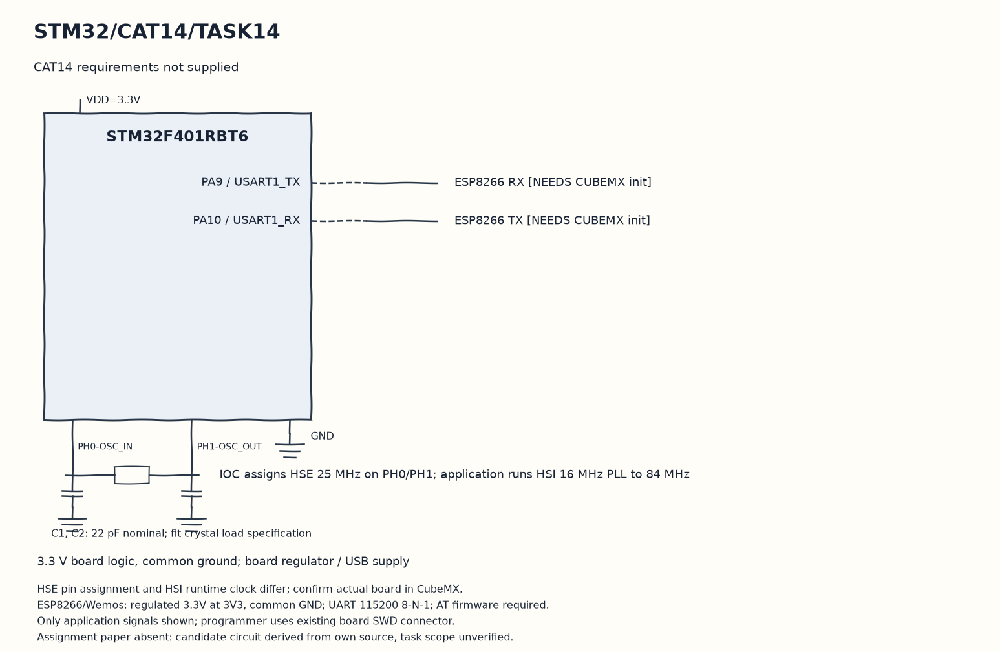

EXPERIMENT DETAILS
EXP: CONTINUOUS ASSESMENT 14
DATE: 14/11/2026
NAME OF EXP: CAT14 paper not supplied
HARDWARE SETUP / PLATFORM: STM32F401RB development board (physical board unconfirmed) + STM32F401RBT6 + ESP8266 + STM32CubeMX (MDK-ARM project)
TASK 14 : CAT14 requirements not supplied

1. Circuit Diagram
Publish the greeting every second after the UART setup is supplied to demonstrate 14 with the shown signals.

* Microcontroller / Board: STM32F401RB development board (physical board unconfirmed) + STM32F401RBT6.
* GPIO / Peripheral pins: PA9 / USART1_TX -> ESP8266 RX [NEEDS CUBEMX init]; PA10 / USART1_RX -> ESP8266 TX [NEEDS CUBEMX init].
* Clock: IOC assigns HSE 25 MHz on PH0/PH1; application runs HSI 16 MHz PLL to 84 MHz.
* External components / Peripheral: ESP8266 RX [NEEDS CUBEMX init]; ESP8266 TX [NEEDS CUBEMX init].
* Power Supply: 3.3 V board logic, common ground; board regulator / USB supply.

2. Core Logic / Pseudocode / Code Base
Working Principle: The candidate source connects an ESP library client and publishes Good Morning on stm32/data. It references huart1 without a generated handle or startup call in this scaffold, so the external declaration only prepares it for regeneration.

Pseudocode:

1. Initialize HAL, the stored clock and GPIO.
2. Use the pending huart1 configuration for the saved ESP connection sequence.
3. Connect the MQTT client to the broker stored in the source.
4. Publish the greeting every second after the UART setup is supplied.

Code Base:
The program is written in Embedded C using STM32 HAL (STM32CubeMX).

* `main.h` provides the project HAL declarations in this program.
* `ESPLib.h` declares the own ESP and MQTT library interface in this program.
* `ESP8266_Init()` tests and configures the ESP station interface here.
* `ESP8266_wifiConnect()` sends the saved access-point connection settings here.
* `ESP8266_portConnect()` opens the stored TCP broker connection here.
* `MQTT_connectBroker()` sends the MQTT client connection packet here.
* `MQTT_publishTopic()` sends the topic and application payload through the ESP library here.
* `HAL_Delay()` waits for the programmed millisecond interval here.

3. Inference
This candidate is a greeting publisher, not verified CAT14 assignment evidence. The missing paper prevents title and scope verification, and CubeMX must supply the UART before the application can link and communicate.

NEEDS CUBEMX: Paper missing. Own F401 IOC lists USART1 PA9 TX / PA10 RX, but main lacks generated handle and MX_USART1_UART_Init. Regenerate actual MCU with USART1 asynchronous 115200 8-N-1, TX/RX, no flow control, HSI16 PLL84MHz as original clock. Then ensure generated init is called before ESP8266_Init. Confirm assignment scope first.

Date note: no paper was available, so the date uses the original candidate lab file last-modified date. Experiment and task wording above report the absent requirements rather than invent a title.
