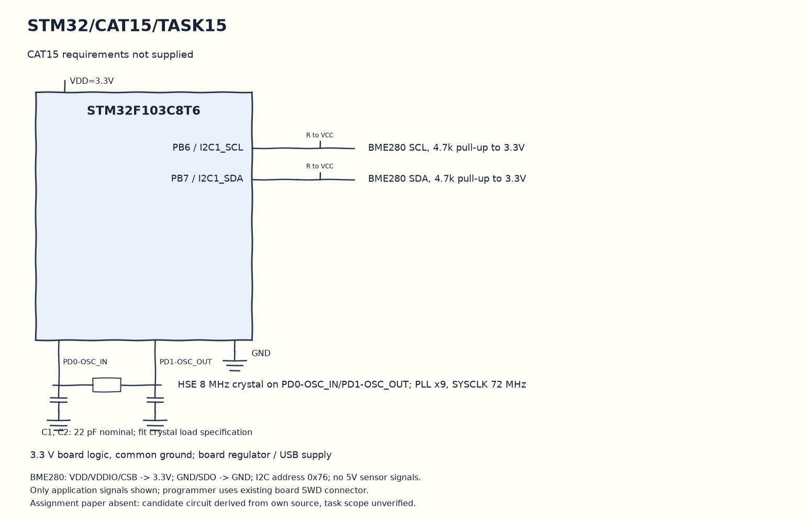

EXPERIMENT DETAILS
EXP: CONTINUOUS ASSESMENT 15
DATE: 14/11/2026
NAME OF EXP: CAT15 paper not supplied
HARDWARE SETUP / PLATFORM: Blue Pill development board + STM32F103C8T6 + BME280 + STM32CubeMX (MDK-ARM project)
TASK 15 : CAT15 requirements not supplied

1. Circuit Diagram
Update the saved variables on success and wait one second to demonstrate 15 with the shown signals.

* Microcontroller / Board: Blue Pill development board + STM32F103C8T6.
* GPIO / Peripheral pins: PB6 / I2C1_SCL -> BME280 SCL, 4.7k pull-up to 3.3V; PB7 / I2C1_SDA -> BME280 SDA, 4.7k pull-up to 3.3V.
* Clock: HSE 8 MHz crystal on PD0-OSC_IN/PD1-OSC_OUT; PLL x9, SYSCLK 72 MHz.
* External components / Peripheral: BME280 SCL, 4.7k pull-up to 3.3V; BME280 SDA, 4.7k pull-up to 3.3V.
* Power Supply: 3.3 V board logic, common ground; board regulator / USB supply.

2. Core Logic / Pseudocode / Code Base
Working Principle: The candidate End_project reads a BME280 through I2C1 using its stored Bosch callbacks. The API call signatures are aligned with its supplied driver, and successful values are kept in temperature, pressure and humidity for inspection.

Pseudocode:

1. Set the sensor address and callbacks.
2. Initialize calibration, one-times oversampling and normal mode.
3. Read and compensate all sensor channels.
4. Update the saved variables on success and wait one second.

Code Base:
The program is written in Embedded C using STM32 HAL (STM32CubeMX).

* `main.h` provides the project HAL declarations in this program.
* `stdio.h` provides the formatted text functions in this program.
* `bme280.h` declares the Bosch sensor API in this program.
* `user_i2c_read()` adapts the Bosch read callback to HAL here.
* `user_i2c_write()` adapts the Bosch write callback to HAL here.
* `user_delay_us()` rounds the Bosch microsecond delay request up to a HAL millisecond wait here.
* `bme280_init()` reads sensor calibration through the supplied callbacks here.
* `bme280_set_sensor_settings()` applies the saved oversampling and filter settings here.
* `bme280_set_sensor_mode()` selects normal sensor operation here.
* `bme280_get_sensor_data()` obtains compensated sensor channel values here.
* `HAL_Delay()` waits for the programmed millisecond interval here.

3. Inference
The candidate provides debugger-visible sensor variables and no UART measurement printout. This demonstrates the behavior of the available End_project source; its suitability for CAT15 cannot be checked without the paper.

Date note: no paper was available, so the date uses the original candidate lab file last-modified date. Experiment and task wording above report the absent requirements rather than invent a title.
