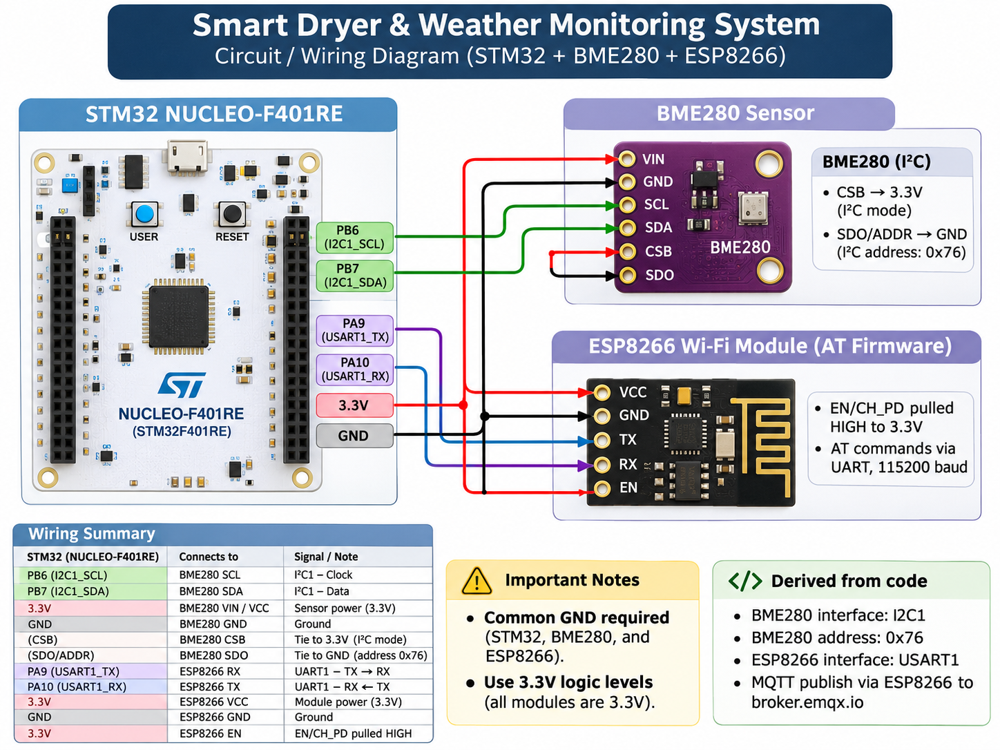
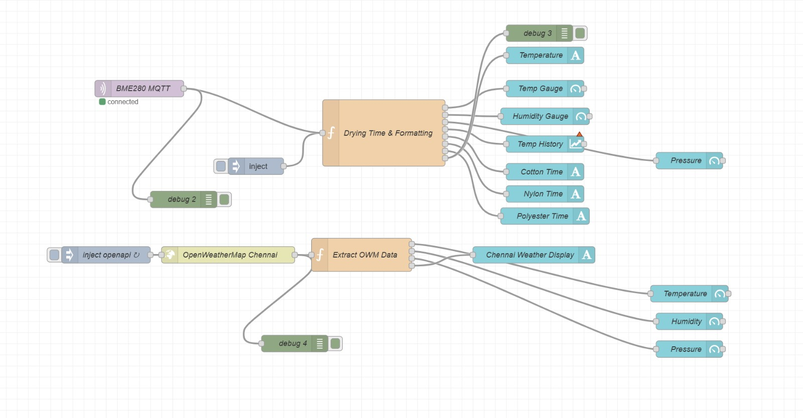
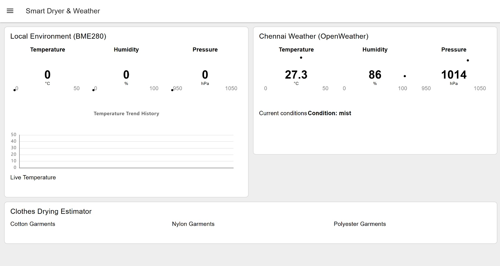

# EXP: CONTINUOUS ASSESSMENT 15

| Field | Details |
|---|---|
| Project Title | Smart Dryer & Weather Monitoring System |
| Date of Execution | 05/11/2026 (to be confirmed) |
| Hardware Platform | STM32 NUCLEO-F401RE + BME280 Environmental Sensor + ESP8266 Wi-Fi Module |
| Course | 25CS2741 – Fundamentals of Internet of Things + Lab |
| Student Name | Sishira A V |
| Register Number | 25011102098 |
| Cloud & Analytics Stack | MQTT (broker.emqx.io:1883), OpenWeather API, Node-RED Dashboard 2.0 |

## 1. Project Overview & Scope

This project implements an IoT-based environmental monitoring and intelligent clothes drying estimation system using the STM32 NUCLEO-F401RE microcontroller.

The Bosch BME280 environmental sensor acquires ambient temperature, relative humidity and atmospheric pressure through the I2C communication protocol. The acquired sensor measurements are processed by the STM32 and formatted into lightweight JSON packets.

An ESP8266 Wi-Fi module communicates with the STM32 through USART1 using AT commands and transmits the sensor data to a public MQTT broker.

Node-RED acts as the data processing, analytics and visualization platform. In addition to local environmental measurements, the system retrieves regional weather information for Chennai through the OpenWeather API.

The dashboard incorporates a Clothes Drying Estimator that calculates approximate drying durations for cotton, nylon and polyester garments based on local temperature and humidity conditions.

### Project Objectives

- Interface the BME280 environmental sensor with the STM32 microcontroller.
- Establish wireless communication using the ESP8266 Wi-Fi module.
- Publish environmental measurements using MQTT.
- Retrieve Chennai weather information using the OpenWeather API.
- Visualize local and regional environmental parameters using Node-RED.
- Monitor local temperature trends.
- Estimate material-specific clothes drying durations.
- Demonstrate end-to-end edge-to-cloud IoT communication.

## 2. Hardware Platform & Circuit Diagram

### Hardware Components

| Component | Specification |
|---|---|
| Development Board | STM32 NUCLEO-F401RE |
| Microcontroller | STM32F401RET6, ARM Cortex-M4 with FPU |
| System Clock | 84 MHz configured target |
| Environmental Sensor | Bosch BME280 |
| Wi-Fi Module | ESP8266 with AT command firmware |
| Sensor Communication | I2C1 at 100 kHz |
| Wi-Fi Communication | USART1 at 115200 baud |
| Sensor I2C Address | 0x76 |
| Logic Voltage | 3.3 V |
| Supporting Components | Jumper wires and suitable power supply |

### Pin Mapping Table

| STM32 Pin | Peripheral / Signal | Connected Module | Module Pin | Description |
|---|---|---|---|---|
| PB6 | I2C1_SCL | BME280 | SCL | I2C serial clock |
| PB7 | I2C1_SDA | BME280 | SDA | I2C serial data |
| PA9 | USART1_TX | ESP8266 | RX | UART data transmission |
| PA10 | USART1_RX | ESP8266 | TX | UART data reception |
| 3.3V | Power Supply | BME280 | VCC | Sensor power supply |
| 3.3V logic | Enable Signal | ESP8266 | EN / CH_PD | Module enable, if exposed |
| GND | Ground | BME280 | GND | Common ground |
| GND | Ground | ESP8266 | GND | Common ground |

The ESP8266 must be powered using a suitable supply for the specific module, with adequate current capacity and a common ground reference.

For BME280 modules exposing CSB and SDO pins, CSB is connected high for I2C operation and SDO is connected low to select address 0x76. Suitable I2C pull-up resistors are required if not already present on the breakout board.

### Circuit Diagram



*Figure 1: Hardware wiring diagram illustrating the STM32, BME280 and ESP8266 connections based on the firmware pin configuration.*

## 3. System Architecture

The system consists of four principal layers:

### Sensing Layer

The BME280 sensor measures:

- Ambient temperature in degrees Celsius.
- Relative humidity in percentage.
- Atmospheric pressure in hectopascals.

### Edge Processing Layer

The STM32 microcontroller initializes the sensor, reads compensated environmental measurements and converts them into JSON telemetry.

### Communication Layer

The ESP8266 establishes a Wi-Fi connection using AT commands. MQTT packets are transmitted through a TCP connection to the public MQTT broker.

### Analytics and Visualization Layer

Node-RED receives MQTT telemetry, retrieves Chennai weather data, processes environmental measurements and displays drying duration estimates.

**Data Pipeline:**

BME280 → STM32 → ESP8266 → MQTT Broker → Node-RED → Dashboard

OpenWeather API → Node-RED → Chennai Weather Dashboard

## 4. STM32 Firmware Implementation

The firmware is developed using STM32CubeMX and Keil µVision with the STM32 HAL library.

### Firmware Operation

1. Initialize the HAL library and system clock.
2. Configure GPIO, I2C1 and USART1 peripherals.
3. Initialize the BME280 sensor at I2C address 0x76.
4. Configure temperature, humidity and pressure oversampling.
5. Set the sensor to normal operating mode.
6. Reset and configure the ESP8266 using AT commands.
7. Establish a Wi-Fi connection.
8. Open a TCP connection to the MQTT broker.
9. Transmit an MQTT CONNECT packet.
10. Read compensated environmental measurements.
11. Format the measurements into JSON.
12. Publish the JSON payload using MQTT.
13. Repeat sensor acquisition approximately every second, subject to communication delays.

### MQTT Configuration

| Parameter | Configuration |
|---|---|
| Broker | broker.emqx.io |
| Port | 1883 |
| Protocol | MQTT 3.1.1 |
| Quality of Service | QoS 0 |
| Data Format | JSON |
| Acquisition Delay | 1000 ms |

The MQTT publishing topic configured in the STM32 firmware must match the subscription topic configured in Node-RED.

### Sample JSON Payload

The following example is provided by the Node-RED test inject node:

```json
{
  "status": "success",
  "temperature": 23.95,
  "humidity": 70.46,
  "pressure": 1016.44
}
```

## 5. Node-RED Environmental Intelligence Dashboard

The dashboard is implemented using FlowFuse Node-RED Dashboard 2.0 and organized into three principal sections.



*Figure 2: Smart Dryer & Weather dashboard displaying local environmental gauges, Chennai weather information, temperature history and clothes drying estimators.*

### 5.1 Local Environment (BME280)

The local environment section receives environmental measurements published by the STM32 through MQTT.

| Parameter | Unit | Gauge Range |
|---|---|---|
| Temperature | °C | 0–50 |
| Relative Humidity | % | 0–100 |
| Atmospheric Pressure | hPa | 950–1050 |

A temperature trend history chart displays incoming temperature measurements over time.

The local gauges and drying estimates require valid BME280 telemetry or an injected test payload.

### 5.2 Chennai Weather (OpenWeather API)

Regional meteorological information is obtained through HTTP requests to the OpenWeather API.

The API response is processed to extract:

- Current temperature.
- Relative humidity.
- Atmospheric pressure.
- Current weather condition.

The API request is configured to execute automatically every 600 seconds (10 minutes).

### Recorded Dashboard Output

The captured dashboard screenshot displays the following OpenWeather readings:

| Parameter | Chennai Weather |
|---|---|
| Temperature | 27.3 °C |
| Relative Humidity | 86% |
| Atmospheric Pressure | 1014 hPa |
| Weather Condition | Mist |

At the time of the screenshot, valid local sensor measurements were not displayed. Therefore, local gauges showed their initialized values and the drying estimates remained blank.

### 5.3 Clothes Drying Estimator

The Clothes Drying Estimator implements a heuristic calculation based on ambient temperature and relative humidity.

Three fabric categories are considered:

| Fabric | Base Drying Duration | Material Characteristics |
|---|---|---|
| Cotton | 4.5 hours | High moisture absorption |
| Nylon | 1.5 hours | Low moisture retention |
| Polyester | 2.0 hours | Hydrophobic synthetic fabric |

The estimated drying duration increases with relative humidity and generally decreases as temperature increases.

### Drying Time Calculation

The humidity and temperature factors are calculated as:

```text
Humidity Factor = max(0.4, Humidity / 60)

Temperature Factor = max(0.5, 28 / max(Temperature, 1))

Drying Factor = Humidity Factor × Temperature Factor
```

The fabric-specific drying estimates are calculated as:

```text
Cotton Drying Time = 4.5 × Drying Factor

Nylon Drying Time = 1.5 × Drying Factor

Polyester Drying Time = 2.0 × Drying Factor
```

The calculated values are rounded to one decimal place and displayed in hours.

These estimates are indicative rather than experimentally calibrated predictions, as actual drying duration also depends on airflow, fabric thickness, initial moisture content and exposure to sunlight.

## 6. Node-RED Telemetry Flow Architecture



*Figure 3: Node-RED processing pipeline illustrating MQTT sensor ingestion, OpenWeather API integration, environmental data processing and dashboard visualization.*

### 6.1 Local Sensor MQTT Branch

The BME280 MQTT input node subscribes to the configured MQTT topic and receives environmental measurements.

The incoming JSON payload is forwarded to the Drying Time & Formatting function node.

The function node performs:

- JSON parsing.
- Sensor payload validation.
- Numeric data conversion.
- Humidity range validation.
- Pressure normalization from Pa to hPa when required.
- Drying duration estimation.
- Routing processed values to dashboard widgets.

### Drying Time & Formatting Function Outputs

| Output Port | Destination |
|---|---|
| 1 | Temperature Gauge |
| 2 | Humidity Gauge |
| 3 | Pressure Gauge |
| 4 | Temperature History Chart |
| 5 | Cotton Drying Time |
| 6 | Nylon Drying Time |
| 7 | Polyester Drying Time |
| 8 | Live Temperature Text and Debug Node |

An inject node provides predefined environmental measurements for offline testing without requiring the physical sensor hardware.

A debug node captures incoming MQTT telemetry for troubleshooting.

### 6.2 Chennai Weather API Branch

The OpenWeather processing branch consists of the following nodes:

1. Inject node for periodic API requests.
2. HTTP request node for retrieving Chennai weather data.
3. Extract OWM Data function node for parsing the API response.
4. Dashboard gauges and weather condition display.
5. Debug node for inspecting API responses.

### Extract OWM Data Function Outputs

| Output Port | Destination |
|---|---|
| 1 | Chennai Temperature Gauge |
| 2 | Chennai Humidity Gauge |
| 3 | Chennai Pressure Gauge |
| 4 | Chennai Weather Condition Display |

## 7. Algorithm / Pseudocode

```text
BEGIN

Initialize STM32 HAL
Configure system clock
Initialize I2C1 and USART1

Initialize BME280 sensor
Configure environmental measurement settings

Initialize ESP8266
Connect to Wi-Fi
Connect to MQTT broker

REPEAT

    Read temperature from BME280
    Read humidity from BME280
    Read pressure from BME280

    Convert measurements into JSON
    Publish JSON through MQTT

    Node-RED receives sensor payload

    Validate environmental measurements
    Normalize pressure if required

    Update temperature gauge
    Update humidity gauge
    Update pressure gauge
    Update temperature history chart

    Calculate humidity factor
    Calculate temperature factor
    Calculate drying factor

    Estimate cotton drying time
    Estimate nylon drying time
    Estimate polyester drying time

    Display calculated drying durations

    Fetch Chennai weather periodically
    Extract weather measurements
    Update regional weather gauges

UNTIL system is stopped

END
```

## 8. Project Directory Structure

```text
CAT15/
├── TASK15/
│   ├── Core/
│   │   ├── Inc/
│   │   └── Src/
│   ├── Drivers/
│   ├── MDK-ARM/
│   ├── .mxproject
│   ├── Weather_MQTT.ioc
│   ├── README.md
│   ├── flows.json
│   ├── circuit.png
│   ├── dashboard.png
│   └── nodered_flow.png
├── images/
│   ├── circuit.png
│   ├── dashboard.png
│   └── nodered_flow.png
├── README.md
├── circuit.png
├── dashboard.png
└── nodered_flow.png
```

### Important Project Files

| File | Description |
|---|---|
| Weather_MQTT.ioc | STM32CubeMX hardware configuration |
| Core/Src/main.c | Primary STM32 application firmware |
| Core/Src/bme280.c | Bosch BME280 sensor driver |
| Core/Inc/bme280.h | Sensor driver header |
| MDK-ARM/Weather_MQTT.uvprojx | Keil µVision project |
| flows.json | Importable Node-RED flow |
| circuit.png | Hardware wiring diagram |
| dashboard.png | Dashboard output |
| nodered_flow.png | Node-RED processing architecture |

## 9. Execution Procedure

### STM32 Firmware

1. Open the Keil µVision project located inside the MDK-ARM directory.
2. Configure the appropriate Wi-Fi network credentials locally.
3. Verify the MQTT publishing topic.
4. Build the project.
5. Connect the STM32 development board.
6. Flash the firmware.
7. Connect the BME280 sensor and ESP8266 module according to the hardware configuration.

### Node-RED

1. Install and start Node-RED.
2. Install the `@flowfuse/node-red-dashboard` package.
3. Open the Node-RED editor.
4. Select Menu → Import.
5. Import the [flows.json](flows.json) file.
6. Configure the OpenWeather API key locally.
7. Ensure that the MQTT subscription topic matches the STM32 publishing topic.
8. Deploy the flow.
9. Open the dashboard at `http://localhost:1880/dashboard/drying`.
10. Monitor the environmental measurements and drying estimates.

Wi-Fi passwords and API keys should not be published in the GitHub repository.

## 10. Technical Inferences

### Environmental Monitoring

The BME280 sensor provides three environmental parameters through a single I2C interface, reducing hardware complexity and enabling integrated microclimate monitoring.

### Local and Regional Weather Monitoring

Combining local sensor measurements with OpenWeather data enables the observation of differences between immediate environmental conditions and regional weather conditions when both sources are available.

### Evaporative Drying Behaviour

Relative humidity and temperature influence the evaporation of moisture from fabrics. Higher humidity generally reduces evaporation, while higher temperatures can promote faster drying.

### Fabric-Specific Drying Estimation

Different base drying durations account for the varying moisture absorption and retention characteristics of cotton, nylon and polyester.

### Edge-to-Cloud Communication

The integration of STM32, ESP8266, MQTT and Node-RED demonstrates a modular IoT architecture separating sensor acquisition, wireless communication, data analytics and visualization.

### Scalability

The system can be extended to incorporate additional sensors, wind speed measurements, rainfall information, historical analytics and automated notifications.

## 11. Result & Conclusion

An IoT-based environmental monitoring and clothes drying estimation system was developed using STM32, BME280, ESP8266, MQTT, OpenWeather API and Node-RED.

The implemented dashboard provides local environmental monitoring widgets, regional Chennai weather information, temperature history visualization and fabric-specific drying duration estimation.

The captured dashboard demonstrates successful retrieval and visualization of OpenWeather data. The Node-RED flow also supports test payload injection for validating the local sensor processing and drying estimation functions.

The project demonstrates the practical integration of embedded systems, wireless networking, cloud-based data retrieval and IoT analytics for an everyday environmental monitoring application.

---

**Student Name:** Sishira A V  
**Register Number:** 25011102098  
**Course:** Fundamentals of Internet of Things + Lab  
**Experiment:** CAT15
