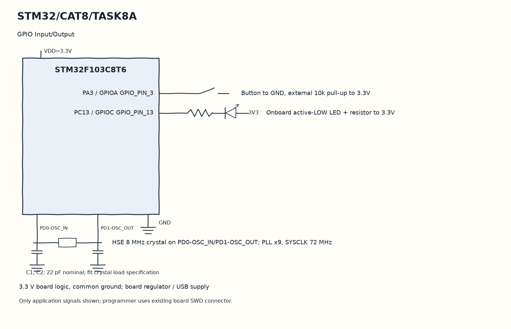

EXPERIMENT DETAILS
EXP: CONTINUOUS ASSESMENT 8
DATE: 18/09/2026
NAME OF EXP: STM32 GPIO Bring-Up and Switch-Controlled LED
HARDWARE SETUP / PLATFORM: Blue Pill development board + STM32F103C8T6 + GPIO LED and input + STM32CubeMX (MDK-ARM project)
TASK 8A : GPIO Input/Output

1. Circuit Diagram
Repeat immediately to demonstrate 8A with the shown signals.

* Microcontroller / Board: Blue Pill development board + STM32F103C8T6.
* GPIO / Peripheral pins: PA3 / GPIOA GPIO_PIN_3 -> Button to GND, external 10k pull-up to 3.3V; PC13 / GPIOC GPIO_PIN_13 -> Onboard active-LOW LED + resistor to 3.3V.
* Clock: HSE 8 MHz crystal on PD0-OSC_IN/PD1-OSC_OUT; PLL x9, SYSCLK 72 MHz.
* External components / Peripheral: Button to GND, external 10k pull-up to 3.3V; Onboard active-LOW LED + resistor to 3.3V.
* Power Supply: 3.3 V board logic, common ground; board regulator / USB supply.

2. Core Logic / Pseudocode / Code Base
Working Principle: The application reads PA3 on each pass through the loop. It writes PC13 high for a low input and writes PC13 low otherwise, without saving any previous switch state.

Pseudocode:

1. Read the GPIOA pin 3 input.
2. Compare it with GPIO_PIN_RESET.
3. Write the corresponding SET or RESET level to GPIOC pin 13.
4. Repeat immediately.

Code Base:
The program is written in Embedded C using STM32 HAL (STM32CubeMX).

* `main.h` provides the project HAL declarations in this program.
* `HAL_GPIO_ReadPin()` reads the application switch level here.
* `HAL_GPIO_WritePin()` writes the selected output level here.

3. Inference
The output level follows the input test continuously. On an active-low PC13 LED, a pressed low input sets the output high, so this original program turns that LED off while pressed.
