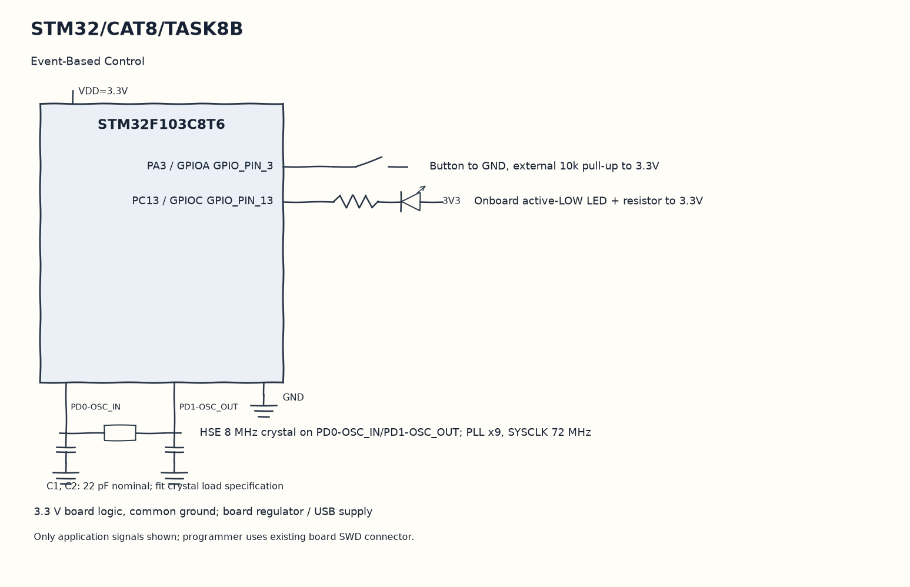

EXPERIMENT DETAILS
EXP: CONTINUOUS ASSESMENT 8
DATE: 18/09/2026
NAME OF EXP: STM32 GPIO Bring-Up and Switch-Controlled LED
HARDWARE SETUP / PLATFORM: Blue Pill development board + STM32F103C8T6 + GPIO LED and input + STM32CubeMX (MDK-ARM project)
TASK 8B : Event-Based Control

1. Circuit Diagram
Toggle PC13 on the qualified release to demonstrate 8B with the shown signals.

* Microcontroller / Board: Blue Pill development board + STM32F103C8T6.
* GPIO / Peripheral pins: PA3 / GPIOA GPIO_PIN_3 -> Button to GND, external 10k pull-up to 3.3V; PC13 / GPIOC GPIO_PIN_13 -> Onboard active-LOW LED + resistor to 3.3V.
* Clock: HSE 8 MHz crystal on PD0-OSC_IN/PD1-OSC_OUT; PLL x9, SYSCLK 72 MHz.
* External components / Peripheral: Button to GND, external 10k pull-up to 3.3V; Onboard active-LOW LED + resistor to 3.3V.
* Power Supply: 3.3 V board logic, common ground; board regulator / USB supply.

2. Core Logic / Pseudocode / Code Base
Working Principle: The code accepts a new PA3 level only after it has stayed unchanged for twenty milliseconds. A qualified release toggles PC13 once, leaving that state saved in the output latch.

Pseudocode:

1. Record the time when the raw input changes.
2. Wait for twenty milliseconds of a stable raw level using HAL_GetTick.
3. Remember a qualified press.
4. Toggle PC13 on the qualified release.

Code Base:
The program is written in Embedded C using STM32 HAL (STM32CubeMX).

* `main.h` provides the project HAL declarations in this program.
* `HAL_GetTick()` returns the millisecond time used for event comparisons here.
* `HAL_GPIO_ReadPin()` reads the application switch level here.
* `HAL_GPIO_TogglePin()` changes the stored LED output state here.

3. Inference
A normal completed press changes the saved LED state once. Timestamp comparison provides debounce without stopping the main loop.
