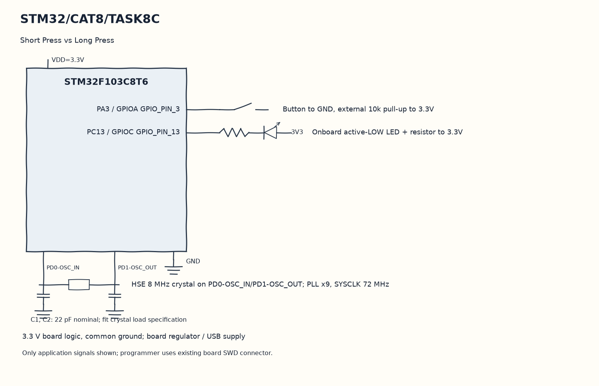

EXPERIMENT DETAILS
EXP: CONTINUOUS ASSESMENT 8
DATE: 18/09/2026
NAME OF EXP: STM32 GPIO Bring-Up and Switch-Controlled LED
HARDWARE SETUP / PLATFORM: Blue Pill development board + STM32F103C8T6 + GPIO LED and input + STM32CubeMX (MDK-ARM project)
TASK 8C : Short Press vs Long Press

1. Circuit Diagram
If blinking is active, toggle PC13 every five hundred milliseconds to demonstrate 8C with the shown signals.

* Microcontroller / Board: Blue Pill development board + STM32F103C8T6.
* GPIO / Peripheral pins: PA3 / GPIOA GPIO_PIN_3 -> Button to GND, external 10k pull-up to 3.3V; PC13 / GPIOC GPIO_PIN_13 -> Onboard active-LOW LED + resistor to 3.3V.
* Clock: HSE 8 MHz crystal on PD0-OSC_IN/PD1-OSC_OUT; PLL x9, SYSCLK 72 MHz.
* External components / Peripheral: Button to GND, external 10k pull-up to 3.3V; Onboard active-LOW LED + resistor to 3.3V.
* Power Supply: 3.3 V board logic, common ground; board regulator / USB supply.

2. Core Logic / Pseudocode / Code Base
Working Principle: A debounced PA3 press saves started and a debounced release measures its duration. Releases after at least one second start periodic blinking, while shorter releases stop blinking and toggle PC13.

Pseudocode:

1. Filter raw switch transitions for twenty milliseconds.
2. Save a timestamp on the stable press.
3. Classify the duration when the stable release arrives.
4. If blinking is active, toggle PC13 every five hundred milliseconds.

Code Base:
The program is written in Embedded C using STM32 HAL (STM32CubeMX).

* `main.h` provides the project HAL declarations in this program.
* `HAL_GetTick()` returns the millisecond time used for event comparisons here.
* `HAL_GPIO_ReadPin()` reads the application switch level here.
* `HAL_GPIO_TogglePin()` changes the stored LED output state here.

3. Inference
Short and long presses select different output behavior using elapsed ticks. Long-press detection keeps running alongside the blink scheduler and uses no blocking hold delay.
