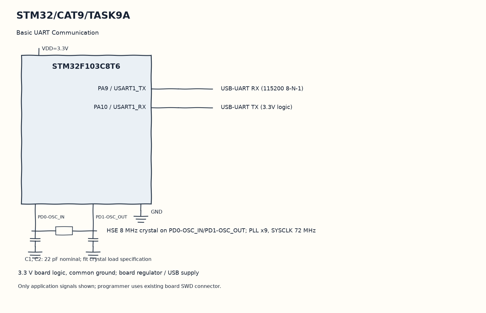

EXPERIMENT DETAILS
EXP: CONTINUOUS ASSESMENT 9
DATE: 28/09/2026
NAME OF EXP: STM32 UART Command Controlled LED
HARDWARE SETUP / PLATFORM: Blue Pill development board + STM32F103C8T6 + USB-UART + STM32CubeMX (MDK-ARM project)
TASK 9A : Basic UART Communication

1. Circuit Diagram
Transmit that character back and repeat reception to demonstrate 9A with the shown signals.

* Microcontroller / Board: Blue Pill development board + STM32F103C8T6.
* GPIO / Peripheral pins: PA9 / USART1_TX -> USB-UART RX (115200 8-N-1); PA10 / USART1_RX -> USB-UART TX (3.3V logic).
* Clock: HSE 8 MHz crystal on PD0-OSC_IN/PD1-OSC_OUT; PLL x9, SYSCLK 72 MHz.
* External components / Peripheral: USB-UART RX (115200 8-N-1); USB-UART TX (3.3V logic).
* Power Supply: 3.3 V board logic, common ground; board regulator / USB supply.

2. Core Logic / Pseudocode / Code Base
Working Principle: The program sends S with CR/LF once after initialization. It then receives a byte with the existing UART_ReceiveChar helper and echoes it with HAL_UART_Transmit.

Pseudocode:

1. Initialize the generated USART1 peripheral.
2. Send the starting S line.
3. Wait for one incoming character.
4. Transmit that character back and repeat reception.

Code Base:
The program is written in Embedded C using STM32 HAL (STM32CubeMX).

* `main.h` provides the project HAL declarations in this program.
* `string.h` provides string length, comparison and buffer functions in this program.
* `UART_TransmitString()` sends a string through the existing USART1 helper here.
* `HAL_UART_Transmit()` sends bytes on the selected UART handle here.
* `strlen()` counts actual string bytes for serial or HTTP length here.
* `UART_ReceiveChar()` waits for and returns one received byte here.
* `HAL_UART_Receive()` receives bytes with the requested timeout here.

3. Inference
The terminal gets a startup line followed by a byte-for-byte echo. This demonstrates blocking HAL transmission and reception using the original serial helper functions.
