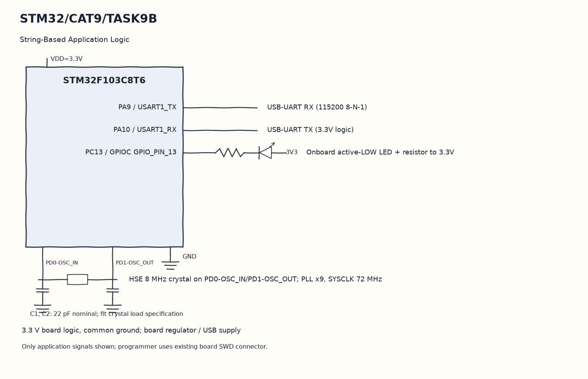

EXPERIMENT DETAILS
EXP: CONTINUOUS ASSESMENT 9
DATE: 28/09/2026
NAME OF EXP: STM32 UART Command Controlled LED
HARDWARE SETUP / PLATFORM: Blue Pill development board + STM32F103C8T6 + USB-UART + STM32CubeMX (MDK-ARM project)
TASK 9B : String-Based Application Logic

1. Circuit Diagram
Set, clear or toggle PC13, send the matching reply and reset the line state to demonstrate 9B with the shown signals.

* Microcontroller / Board: Blue Pill development board + STM32F103C8T6.
* GPIO / Peripheral pins: PA9 / USART1_TX -> USB-UART RX (115200 8-N-1); PA10 / USART1_RX -> USB-UART TX (3.3V logic); PC13 / GPIOC GPIO_PIN_13 -> Onboard active-LOW LED + resistor to 3.3V.
* Clock: HSE 8 MHz crystal on PD0-OSC_IN/PD1-OSC_OUT; PLL x9, SYSCLK 72 MHz.
* External components / Peripheral: USB-UART RX (115200 8-N-1); USB-UART TX (3.3V logic); Onboard active-LOW LED + resistor to 3.3V.
* Power Supply: 3.3 V board logic, common ground; board regulator / USB supply.

2. Core Logic / Pseudocode / Code Base
Working Principle: Characters are collected into a bounded command array until CR or LF arrives. The parser accepts LED ON, LED OFF and LED TOGGLE, changes the active-low PC13 output and sends a reply.

Pseudocode:

1. Send the supported command list.
2. Collect a line while checking the array limit.
3. On the line ending, compare the saved command with the three accepted strings.
4. Set, clear or toggle PC13, send the matching reply and reset the line state.

Code Base:
The program is written in Embedded C using STM32 HAL (STM32CubeMX).

* `main.h` provides the project HAL declarations in this program.
* `string.h` provides string length, comparison and buffer functions in this program.
* `UART_TransmitString()` sends a string through the existing USART1 helper here.
* `HAL_UART_Transmit()` sends bytes on the selected UART handle here.
* `strlen()` counts actual string bytes for serial or HTTP length here.
* `UART_ReceiveChar()` waits for and returns one received byte here.
* `HAL_UART_Receive()` receives bytes with the requested timeout here.
* `strcmp()` matches a complete received command here.
* `HAL_GPIO_WritePin()` writes the selected output level here.
* `HAL_GPIO_TogglePin()` changes the stored LED output state here.

3. Inference
Complete text commands control the onboard LED and get a response. An overlong line is rejected, showing why serial command handling needs both delimiters and a size limit.
